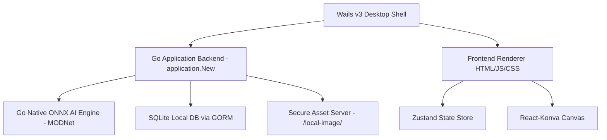
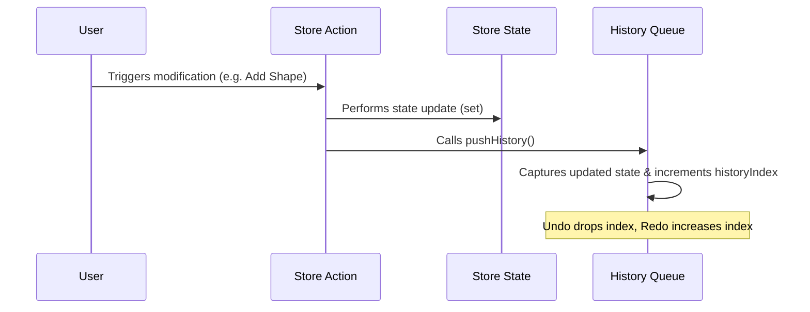

# Grido Studio - Developer Guide & Architecture Documentation

Welcome to the **Grido Studio** developer guide. This document provides an in-depth explanation of the application's architecture, key systems, canvas engine, state management, background processes, testing workflows, and build guides.

---

## 1. Architectural Overview

Grido Studio is built as a hybrid desktop application utilizing **Wails v3** (Go backend) and **React + TypeScript** (Frontend).



### Backend (Go)
- **Framework:** [Wails v3](https://v3.wails.io/) binds Go services and methods to TypeScript automatically via `@wailsio/runtime`.
- **Native AI Background Removal (`internal/service/bg_removal_service_windows.go`):** محرك استدلال محلي فائق السرعة عبر `github.com/yalue/onnxruntime_go` ونموذج `modnet.onnx` المضمنين داخل الثنائي، مع استخراج ذري لمكتبة `onnxruntime.dll` في `%APPDATA%\GridoStudio\bin` ومعالجة متوازية للقناع (`compositeMaskParallel`).
- **Wails App Lifecycle:** Initialized in `main.go` (`application.New`) with services registered via `application.NewService(...)`. Window lifecycle hooks include `OnWindowEvent` (`events.Common.WindowCreated`, `events.Common.WindowClosing`).
- **Database Repository:** SQLite is handled under `internal/repository/db.go`. It manages project serialization, saving, and loading with `CGO_ENABLED=1`.
- **Media Directory:** Local files are written to a user-specific AppData directory (accessible via `utils.GetAppDir()`).
- **Custom Asset Handler:** Configured in `main.go` via `application.AssetOptions{Handler: ...}` to serve local files. Wails maps the route `/local-image/*` directly to local files saved on disk in the application directory with strict `filepath.EvalSymlinks` validation.
- **Local `/api` Guard (`internal/service/local_api_guard.go`):** كل طلب على `/api/*` (كتابة ملفات في `Media`/`Exports` ورفع صور الطباعة وحفظ الملفات) يجب أن يجتاز شرطين: أصل مطابق لمضيف الخادم، وترويسة `X-Grido-Session` تحمل توكن العملية العشوائي (32 بايت لكل تشغيل) بمقارنة زمن ثابت (`utils.SecureTokenEqual`). التوكن يُسلَّم للواجهة عبر ربط Wails وحده (`App.GetLocalApiToken`) — أي أنه غير قابل للوصول من متصفح أو عملية خارجية — ولا يُسجَّل في أي لوج. السياسة **فشل مغلق**: تعذّر توليد التوكن ⇒ رفض كل الطلبات. عميل الواجهة الموحّد `frontend/src/lib/local-api.ts` (`fetchLocalApi`) يضيف الترويسة تلقائياً، ويُمنع إضافة مستدعٍ جديد لهذه المسارات بدونه.
- **Update Integrity (`internal/service/updater.go`):** سلسلة الثقة ثلاث مراحل صريحة: (1) رفض بلا بصمة `SHA-256` معلنة، (2) رفض إن لم تطابق البصمة الملفَّ المنزّل، (3) **توقيع Ed25519 بمفتاح عام مثبّت في الثنائي** (`UpdaterPublicKey`، يُحقن بـldflags) — والقيمة فارغة تعني السلوك القديم (بصمة فقط) مع تحذير مسجَّل، ووجودها يجعل التوقيع إلزامياً (Fail-closed). الرسالة الموقَّعة هي **بصمة الملف الخام (32 بايتاً)** لا الملف كاملاً، فلا يُحمَّل ملف بحجم 200MB في الذاكرة للتحقق. وفوق ذلك، يُرفض أي رابط تنزيل **أولي** لا يبدأ بـ`https://` (فشل مغلق **قبل** إنشاء الطلب نفسه — `updater.go:479-481`) — لا على إعادات التوجيه فقط.
- **Accelerated Media Upload & Dimensions (`internal/server/asset_server.go`):** مسار `/api/upload-media` يحسب أبعاد الصورة (`width`, `height`, `aspectRatio`) فور فحص الترويسة والكتابة الذرية ويعيدها ضمن استجابة JSON، مما يسمح للواجهة بحفظها مباشرة في كاش الذاكرة (`aspectRatioCache` في `frontend/src/lib/canvas/image-dimensions.ts`) وتفادي دورات IPC الإضافية أو قراءة DOM البطيئة. كما تتيح `resolveBatchImageAspectRatios` قراءة أبعاد الصور المتعددة دفعةً واحدة بالتوازي عبر خدمة Go `GetBatchImageDimensions`.
- **Binary Clipboard Streaming (`frontend/src/lib/io/clipboard-utils.ts`):** لصق الصور من حافظة النظام يمرر الـ Blob الثنائي مباشرة كـ `multipart/form-data` إلى `/api/upload-media` بدلاً من تحويله إلى DataURL Base64 في ذاكرة V8، مما يخفف استهلاك الذاكرة وتكلفة معالجة Garbage Collection.

### Frontend (TypeScript + React)
- **Framework:** Vite-powered React with TypeScript.
- **Styling:** Tailwind CSS v4 + رموز تصميم Fluent 2 (`--canvas-*`, `--z-*`, `--ruler-*`, `--print-*`) في `src/index.css` — صفر قيم hex/slate خارجة عن النظام.
- **Canvas Engine:** `react-konva` wraps the standard Konva HTML5 2D Canvas library.
- **State Management:** Zustand managing canvas nodes, editor modes, printing configurations, and history.

---

## 2. Canvas Engine & Geometry

The editor operates in two modes: **Collage Mode** (fixed slot layouts) and **Single/Design Mode** (free-form layer-based canvas).

### Coordinate System (Normalized Percentages)
To support responsive canvas resizing without losing element proportions, Grido stores all dimensions and positions in **normalized percentages** (values between `0.0` and `1.0` relative to the A4 workspace boundaries):

$$\text{Pixel Position} = \text{Normalized Coordinate} \times \text{Canvas Dimension}$$

- **State Storage:** `x`, `y`, `width`, `height` are stored as fractions (e.g. `x: 0.35` on a `1200px` canvas is `420px`).
- **Rendering:** Values are converted dynamically to pixels when rendered inside `konva-elements.tsx`:
  ```tsx
  x={element.x * displayW}
  y={element.y * displayH}
  ```
- **Updates:** Drag/transform handlers divide pixel outputs back by canvas dimensions to update the store:
  ```typescript
  onChange({
    x: node.x() / displayW,
    y: node.y() / displayH,
  });
  ```

### Bounding Boxes & Offsets
- **Transformer:** Konva's `<Transformer>` anchors are customized to match Figma: circular purple anchors (`anchorSize: 10`, `anchorFill: "#4f46e5"`), locked aspect ratios, and padding.
- **Star & Circle Origin Offsets:** Primitives (like Circles and Stars) are rendered using offsets (`offsetX = -width/2` and `offsetY = -height/2`) to align their Konva origin directly with the bounding box corners.
- **Snap Guides:** Interactive smart-alignment lines are generated dynamically using alignment math (in `lib/canvas/snap-utils.ts`) when objects are dragged close to other elements.

### Full-Viewport Stage & Layer Architecture
- **Stage Viewport Model:** In accordance with professional canvas architectures (Figma/Illustrator), `<Stage>` covers 100% of the viewport container dimensions (`viewportW`, `viewportH`). Zoom and pan are governed purely by native Stage transformations (`stage.scale({ x, y })` and `stage.position({ x, y })`), eliminating dynamic stage canvas reallocations and VRAM thrashing.
- **Fixed `pixelRatio`:** `Konva.pixelRatio` is clamped to `Math.min(window.devicePixelRatio || 1, 2)` once upon component mounting, completely preventing element jitter and flashing during wheel zooming ticks.
- **Bounded Navigation (`clampStagePos`):** Restricts paper position to prevent drifting into empty infinity:
  - *Wheel scroll mode:* Locks exactly to viewport center when sheet fits on screen; scrolls strictly within sheet edges with a 40px margin when sheet exceeds viewport height.
  - *Free-Pan mode (Spacebar/Middle-drag):* Preserves at least 150px of the paper visible inside viewport bounds.
- **Multi-Layer Separation (`KonvaOverlayLayer`):** Separates the `<EditorTransformer>` and marquee selection rectangle (`marquee-rect`) into an isolated top `<Layer name="overlay-tools-layer">`. Content elements (`KonvaSingleLayer`) remain untouched and do not redraw during marquee selections or transformer handle interactions.

---

## 3. Zustand Editor Store & History Stack

The global store is structured into **8 domain-specific slices** under `frontend/src/lib/store/slices/` and combined in `frontend/src/lib/store/index.ts` (re-exported via `frontend/src/lib/editor-store.ts` for backward compatibility):

1. **`core-slice.ts`**: Canvas dimensions, paper presets, DPI, orientation, background color, project metadata, reset/clear.
2. **`element-slice.ts`**: Adding, updating, deleting, locking, ordering, duplicating, flipping, rotating, and aligning freeform elements (images, text, shapes).
3. **`collage-slice.ts`**: Collage templates, slot assignment, slot image transformations (`zoom`, `dragX`, `dragY`, `flip`, `rotation`), slot sizing, and spacing.
4. **`grid-slice.ts`**: Grid type, grid color, grid opacity, snap-to-grid, columns, gap, margin, and bleed/safe guidelines (`showBleedGuides`, `bleedMarginMM`, `safeMarginMM`, `cutShapeType`).
5. **`history-slice.ts`**: State snapshots for Undo/Redo with shallow cloning (`elements.map(el => ({...el}))`) and a double cap (30 entries / 50MB). Every undoable field is declared once in the `history-snapshot.ts` registry (`SNAPSHOT_KEYS` + `SNAPSHOT_FIELDS`), which derives capture (`captureHistoryEntry`), restore, comparison (`snapshotValuesEqual`), and defaults (`DEFAULT_HISTORY_ENTRY_EXTRAS`) — adding a field is two lines in the registry, enforced by a type-level test that fails if any `HistoryEntry` field is missing from `SNAPSHOT_KEYS`. `loadProject` seeds a full snapshot via `seedHistorySnapshot(get())` after its normalizations.
6. **`license-slice.ts`**: Supabase authentication (email/password, OTP, Google OAuth), active session, JWT token, plan type, and AI quotas.
7. **`print-slice.ts`**: Print configuration, margins, bleed area, cut lines, copy distribution, paper dimensions, and smart N-up sheet imposition (`calculateOptimalSheetImposition`).
8. **`workflow-slice.ts`**: Quick vs. Studio workflow mode (`quick` hides the freeform-elements tabs for photography studios; persisted to `localStorage` under `grido_workflow_mode`).

### State History Queue (Undo & Redo)
Grido manages a history queue of states to allow stepping backwards and forwards:



- **History Pushes:** To prevent breaking the Redo chain, store mutating actions (`addTextElement`, `duplicateElement`, `removeElement`, etc.) apply the state update **first**, and then call `pushHistory()` immediately.
- **Property Change Throttling:**
  - **Color Pickers:** Call `pushHistory()` only when the picker popover closes (`onOpenChange(false)`).
  - **Text & Number Inputs:** Call `pushHistory()` `onBlur` once the user finishes typing.
  - **Interactive Dragging:** Calls `pushHistory()` `onDragEnd` / `onTransformEnd`.

---

## 4. AI Background Removal Engine

Background removal is powered by **`selfie_multiclass.tflite`** running entirely on the client side inside a Web Worker.

- **Technology Stack:** `@mediapipe/tasks-vision` (`ImageSegmenter` with GPU delegate) — model is served locally from `frontend/public/models/`.
- **Background Worker (`workers/bg-removal.worker.ts`):** The full pipeline (model loading, image decode, resize to 1024px max, inference, mask bytes generation) runs off the main thread to keep the UI responsive.
- **Real Cancellation:** Cancel = hard `terminate()` of the Worker from the host (`use-bg-removal.ts`), aborting inference instantly; a fresh Worker is spawned per operation.
- **Blob-to-Base64 Offloading:** Converting the mask bytes to a `base64` string is performed **inside the Web Worker** using a chunked array buffer loop. The base64 data is then sent to Wails, bypassing the slow synchronous `FileReader` blocking on the main UI thread.

---

## 5. Build, Run, & Test

### Local Development
To run the application locally with hot-reloading enabled for both frontend and backend:
```bash
wails3 task dev
```
> Requires Wails v3 CLI: `go install github.com/wailsapp/wails/v3/cmd/wails3@v3.0.0-beta.28`
> The Vite dev server runs on `127.0.0.1:9245` (see `frontend/vite.config.ts` — keep `playwright.config.ts` in sync).

> 🧱 Frontend bindings are generated into `frontend/bindings/` (git-ignored) and are required for
> `tsc`/`vite build`:
> ```bash
> wails3 generate bindings -ts -clean=true
> ```
> `frontend/wailsjs/**` files are **hand-written shims** re-exporting those bindings — never regenerate
> them with the Wails v2 CLI (`wails generate module`).

### Running Tests
To verify all application layers compile and operate successfully:

#### 1. Backend Tests (Go)
Checks SQLite queries, backup logs, and project services.
```bash
go test ./internal/...
```

#### 2. Frontend Unit Tests (Vitest)
Checks Zustand store initial values, mutations, and Undo/Redo logic.
```bash
npm run test
```

#### 3. E2E & Visual Regression Tests (Playwright)
Executes end-to-end user flows in a headless browser env.
```bash
npm run test:e2e
```

### Production Build
To build the optimized production desktop binary:
```bash
wails3 task build
```
The compiled executable will be placed in the `bin/` folder (`BIN_DIR` in `Taskfile.yml`).

### Print Export Pipeline (PNG/JPEG/TIFF + Vector PDF)
`internal/service/print_service.go` (تحقق + تنسيق) → `print_compose.go` (رسم gg)
→ `print_cmyk.go` (CMYK) → `print_export.go` (حفظ نقطي) / `print_pdf_export.go` (PDF).

- **النقطي:** PNG/JPEG (sRGB) وTIFF/JPEG (CMYK) + حقن DPI (pHYs/JFIF) + كتابة ذرية + حقن وسوم `XResolution/YResolution/ResolutionUnit` في TIFF عبر `print_tiff_tags.go`.
- **فصل أحبار CMYK في TIFF (`print_cmyk_tiff.go`):** مُرمِّز مستقل يكتب TIFF 6.0 بـ `PhotometricInterpretation=5` (Separated) و`InkSet=1` و`SamplesPerPixel=4` و`BitsPerSample=[8,8,8,8]` و`Compression=8` (Deflate) بلا `ExtraSamples`، ثم يُمرّر الخرج إلى `injectTIFFResolution` لإضافة وسوم الدقة (تخطيط الرأس ← الشريط ← `BitsPerSample` ← `IFD0` في الذيل يجعل كل الإزاحات قبل نهاية الـIFD فلا تُشوَّه بالحقن). السبب: `golang.org/x/image/tiff` يكتب `*image.CMYK` كـ RGB موسوم `photometric=2` بقناة ألفا (فصل الأحبار يضيع)، و`image/jpeg` القياسي يكتب 3 مكوّنات ولا يدعم CMYK — أي أن مخرج **JPEG يبقى بفضاء RGB** ويُوثّق ذلك في واجهة التصدير نفسها.
- **مسارات الوصول إلى CMYK:** حوار **الطباعة** لا يعرض فضاء الألوان (يطبع عبر WebView2 بـ sRGB حصراً)، وفصل الألوان يُطلب من حوار **التصدير** عبر `runCmykExport` في `frontend/src/lib/export/export-cmyk.ts` الذي يبني `PrintRequest` بعنصر واحد يملأ الورقة ويقرأ ملف `print_*` الناتج من `/local-image/`.
- **سياسة نطاق الإدخال (RV-Print-07/08):** `ImageSrc` مقبول فقط كـ `data:` أو `/local-image/`،     ومسارات الملفات التي تنحلّ داخل `GRIDO_APP_DIR` بعد `EvalSymlinks`؛ وتُفحص ترويسة الصورة بـ`DecodeConfig` (سقف 100MP) قبل أي فكّ.
- **سقوف ذاكرة التركيب (RV-Print-26):** ثابتا سياسة واحدان `maxCanvasPixels = 144_000_000` و`maxCanvasSidePx = 65535` (`print_service.go:44`) يحكمان كانفس الوضع الحر وأبعاد العناصر في `validateCanvasComposition` (`print_service.go:166`) وهدف التحجيم قبل `imaging.Resize` وقبل أي `int(...)` (`print_compose.go:353-367`)، مع `recoverPrintWorkerPanic` (`print_service.go:206`) يحوّل أي panic في عاملي `GeneratePrintSheet`/`composeCanvas` إلى خطأ مفهرس بدل إسقاط العملية. الأبعاد غير الصالحة (صفرية/`NaN/Inf`/فوق السقف) تُرفض برسالة عربية واضحة.
- **WYSIWYG القلب/التدوير (RV-Print-27):** القلب (`FlipH/FlipV`) يُطبَّق بعد الاقتصاص وقبل التدوير — مطابقةً لمصفوفة المجموعة في Konva T·R·S (وفي CSS يُقدَّم `rotate` على `scaleX/scaleY`)؛ والاقتصاص يبقى أولاً لأنه في فضاء المصدر على عقدة الصورة. التطبيق المعكوس (قلب بعد تدوير) كان يعكس المخرج 180° عند 90°/270 في Go وفي معاينة الطباعة معاً (`print_image_pipeline.go:701-711` · `print-preview.tsx:165,184`).
- **PDF المتجهي (`exportFormat: "pdf"` — sRGB فقط):** صفحة مخصصة بالمقاس الفيزيائي
  الدقيق عبر `gofpdf.NewCustom` (مكتبة pure-Go بلا cgo — آمنة للبناء المتقاطع)،
  تضمين JPEG بجودة 95 بلا إعادة ترميز، وخطوط قص متجهة (`Line` + `SetDashPattern`
  بنفس إيقاع `drawCutLines`). يُرفض CMYK→PDF صراحةً برسالة توجيهية.
- **العقد:** `domain.PrintRequest.ExportFormat` (`"png"`, `"jpeg"`, `"tiff"`, `"pdf"`) —
  أي قيمة جديدة تُضاف هنا وفي `print_export.go` مع اختبار مسار في `print_*_test.go`.

### Print Studio & System Printing Engine (Backstage View)
- **واجهة الاستوديو:** شاشة كاملة متسعة بنمط Backstage View في `frontend/src/components/editor/dialogs/print-dialog.tsx` مخصصة لتجهيز الورقة والاتجاه والهوامش وخطوط القص مع طاولة معاينة مركزية فسيحة بنمط Lightbox بنسبة 1:1.
- **محرك الطباعة المباشر (WebView2):** يعتمد على حقن حاوية طباعة دقيقة مع `@page` وهوامش صفرية واستدعاء `window.print()` مباشرة، متفادياً معالج صور ويندوز العتيق (`photowiz.dll`).
- **تفضيلات درايفر الطابعة (Windows):** استدعاء نافذة إعدادات الشركة المصنّعة الرسمية عبر `rundll32.exe printui.dll,PrintUIEntry /e /n` بطلب المستخدم.

For the NSIS installer (requires `makensis` on PATH):
```bash
wails3 task package
```
The installer is produced at `build/windows/nsis/GridoStudio-installer.exe`.

> ℹ️ **ملاحظة أدوات:** `go vet ./...` و`go build ./...` يعملان بصورة تامة ومباشرة بعد إزالة سقالات الهواتف غير المستخدمة (`build/ios` و`build/android`).

---

## 6. Documentation System (إلزامي)

نظام التوثيق في هذا المستودع **مُلزِم** وليس اختيارياً:

- **الوثيقة الحاكمة:** [`docs/DOCUMENTATION_MAP.md`](DOCUMENTATION_MAP.md) — جرد كل مستند ودوره، مصفوفة «ما تغيّر ← ما يجب توثيقه»، الأرقام المرجعية بأوامرها، والبوابات الثلاث.
- **الأداة المنفِّذة:** `scripts/docs-gate.mjs` — تفحص انحراف الأرقام، وتغطية الجرد، ووجود توثيق مرافق لأي تغيير كود، وسلامة مراجع المسارات في `.agents/`.
- **الفرض:** `.husky/pre-commit` (بوابة قبل الكومت) + `.husky/pre-push` (بوابة قبل الدفع) + خطوة `Documentation Gate` في `.github/workflows/ci.yml`.
- **المهارة:** `.agents/skills/grido-docs-sync-guard/SKILL.md` — البوابات وقوائم الفحص وضوابط الأرقام وقواعد «التاريخ لا يُعاد كتابته».
- **القاعدة الحاكمة:** `.agents/AGENTS.md` → «بوابة التوثيق الإلزامية (Documentation Sync Gate — Mandatory)».

لماذا؟ لأن كل انحراف توثيقي سابق (أرقام اختبارات، عائلات خطوط، أسرار ميتة، مسارات وهمية) كلّف جلسات كاملة للاكتشاف والتصحيح. البوابة تحوّل هذا الاكتشاف إلى **فشل آلي فوري**.

