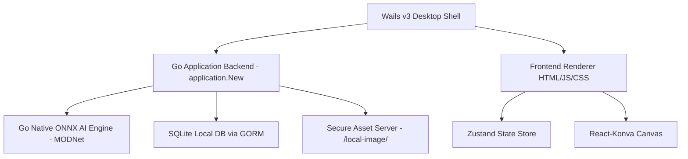
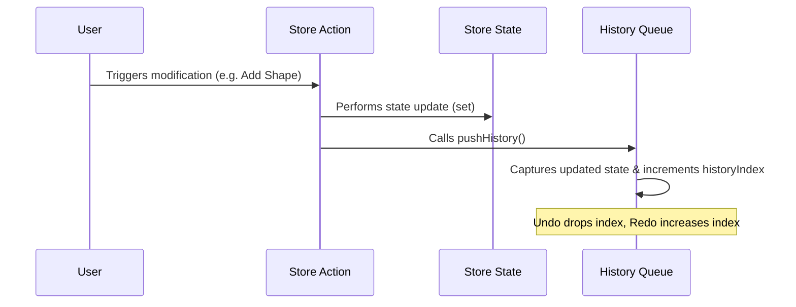

# Grido Studio - Developer Guide & Architecture Documentation

Welcome to the **Grido Studio** developer guide. This document provides an in-depth explanation of the application's architecture, key systems, canvas engine, state management, background processes, testing workflows, and build guides.

---

## واجهة محرر الكولاج الحر — 28 أكتوبر 2026

- `frontend/src/features/freeform-collage/components/freeform-collage-modal.tsx` يملك مستند التحرير وحارس المسودة كما سابقاً، ويجمع كروم النافذة ولوحة Radix ذات تبويبات إدراج/تعبئة/خصائص. حالة اللوحة مستقلة عن سجل المستند؛ إخفاؤها لا يزيل الخلايا ولا يضيف لقطة تراجع، وتحديد خلية يفتح تبويب خصائصها دون إجبار اللوحة المخفية على الظهور.
- `freeform-left-tools-panel.tsx` يعرض وضع الإدراج أو التعبئة. اختيار استراتيجية التعبئة لا يستدعي المحرك قبل الضغط على «تعبئة الورقة»، وتبقى الاستراتيجية المختارة عند التنقل بين التبويبات. `freeform-right-inspector-panel.tsx` يحرر الخلية الأساسية فقط ويصرّح بذلك عند التحديد المتعدد.
- `freeform-canvas-editor.tsx` معاينة DOM لهندسة الخلايا النسبية، وليست Konva جديدة. الملاءمة تستخدم وحدات حاوية CSS على محورَي العرض والارتفاع؛ التكبير محلي للمعاينة من 50% إلى 300% من مقياس الملاءمة، والتحريك والتحجيم يستعملان أبعاد الورقة المعروضة عبر `getBoundingClientRect`. مسارات الطباعة والتصدير وGo والمتجر لم تتغير.
- `FreeformToolButton` في `freeform-top-action-bar.tsx` يوحّد أدوات الأيقونات والتلميحات وحالة `aria-pressed` في الشريط ومحدد الورق وشريط التكبير. `freeform-slot-card.tsx` يعرض أرقام الخلايا وأبعادها بدل خيال الأشخاص، مع مقابض تحجيم خارج حدود الخلية.
- قيد مضيف قائم: الانتقال بين هيكلي سطح المكتب والهاتف يعيد تركيب `CustomCollageCard` المستضيف فيغلق محرره المحلي؛ لم يُنقل مالك المسودة إلى مستوى التطبيق ضمن إعادة التصميم هذه.

## مراجعة توحيد الأدوات وإصلاحات ما قبل الرفع — 28 أكتوبر 2026

- مجلد التصدير يُنشأ عبر `utils.GetExportsDir`، وفحوص نطاق المسارات تشترك في `PathWithinDir` و`PathWithinDirInclusive`. حارسا الطباعة الأصلية وGDI يحوّلان مجلد التصدير إلى مسار مطلق قبل `EvalSymlinks`، حتى يعمل تجاوز `GRIDO_APP_DIR` النسبي مع بقاء رفض المجلد الشقيق `ExportsEvil`.
- تصحيح Windows بعد CI: يُحوَّل مسار الملف نفسه إلى مطلق قبل `EvalSymlinks`، لا بعده فقط؛ حلّ الرابط بمسار نسبي لا يطبّع بادئات Windows وأسماء 8.3 كما يفعل الحلّ المطلق، فتختلف المقارنة مع مجلد Exports المطبع. ينطبق الترتيب نفسه على الطباعة الأصلية وGDI.
- `sanitizeNativePrintFilePath` في `internal/service/print_native.go` يفصل التحقق عن إطلاق برنامج الطباعة؛ `PrintNative` يستعمله فعلياً دون تغيير توقيع IPC، وتختبره حالات الانحدار دون فتح نافذة نظام.
- توحيد تفاصيل رسم خطوط القص عبر `cutLinePixels`، والتحويل إلى CMYK عبر `rgbToRichCMYK`، ومسار تركيب الورقة في خدمات التصدير والطباعة. هذه إعادة استخدام للمنطق الحالي وليست تغييراً في هندسة الخلايا أو فضاء اللون.
- الواجهة تستخدم `persistPickedImage` لتثبيت صور DataURL، و`isLocalApiAvailable` لفحص إمكانية استعمال جسر HTTP، و`isAutoFillGridEnabled`/`setAutoFillGridEnabled` للتفضيل المحلي، و`downloadJsonFile` لتنزيل JSON عبر سجل الروابط المؤقتة. تحويلات المليمتر والبكسل تعتمد مكتبة `canvas/units`، وأقصى نسخة عرض يعتمد `MAX_DISPLAY_DIM`، وقائمة الورق المشتركة `ALL_PAPER_SIZES`.
- ألواح تبويبات الكولاج غير النشطة موجودة كحاويات مخفية بلا محتوى ثقيل، لتبقى مراجع `aria-controls` صحيحة مع استمرار تركيب الأداة النشطة وحدها.

## 1. Architectural Overview

Grido Studio is built as a hybrid desktop application utilizing **Wails v3** (Go backend) and **React + TypeScript** (Frontend).



### Backend (Go)
- **Framework:** [Wails v3](https://v3.wails.io/) binds Go services and methods to TypeScript automatically via `@wailsio/runtime`.
- **Native AI Background Removal (`internal/service/bg_removal_service_windows.go`):** محرك استدلال محلي فائق السرعة عبر `github.com/yalue/onnxruntime_go` ونموذج `modnet.onnx` المضمنين داخل الثنائي، مع استخراج ذري لمكتبة `onnxruntime.dll` في `%APPDATA%\GridoStudio\bin` ومعالجة متوازية للقناع (`compositeMaskParallel`).
- **Wails App Lifecycle:** Initialized in `main.go` (`application.New`) with services registered via `application.NewService(...)`. Window lifecycle hooks include `OnWindowEvent` (`events.Common.WindowCreated`, `events.Common.WindowClosing`).
- **Database Repository:** SQLite is handled under `internal/repository/db.go`. It manages project serialization, saving, and loading with `CGO_ENABLED=1`.
- **Media Directory:** Local files are written to a user-specific AppData directory (accessible via `utils.GetAppDir()`).
- **Custom Asset Handler:** Configured in `main.go` via `application.AssetOptions{Handler: ...}` to serve local files. Wails maps the route `/local-image/*` directly to local files saved on disk in the application directory with strict `filepath.EvalSymlinks` validation.
- **Local `/api` Guard (`internal/service/local_api_guard.go`):** كل طلب على `/api/*` (كتابة ملفات في `Media`/`Exports` ورفع صور الطباعة وحفظ الملفات) يجب أن يجتاز شرطين: أصل مطابق لمضيف الخادم، وترويسة `X-Grido-Session` تحمل توكن العملية العشوائي (32 بايت لكل تشغيل) بمقارنة زمن ثابت (`utils.SecureTokenEqual`). التوكن يُسلَّم للواجهة عبر ربط Wails وحده (`App.GetLocalApiToken`) — أي أنه غير قابل للوصول من متصفح أو عملية خارجية — ولا يُسجَّل في أي لوج. السياسة **فشل مغلق**: تعذّر توليد التوكن ⇒ رفض كل الطلبات. عميل الواجهة الموحّد `frontend/src/lib/local-api.ts` (`fetchLocalApi`) يضيف الترويسة تلقائياً، ويُمنع إضافة مستدعٍ جديد لهذه المسارات بدونه.
- **Update Integrity (`internal/service/updater.go`):** سلسلة الثقة ثلاث مراحل صريحة: (1) رفض بلا بصمة `SHA-256` معلنة، (2) رفض إن لم تطابق البصمة الملفَّ المنزّل، (3) **توقيع Ed25519 بمفتاح عام مثبّت في الثنائي** (`UpdaterPublicKey`، يُحقن بـldflags) — والقيمة فارغة تعني السلوك القديم (بصمة فقط) مع تحذير مسجَّل، ووجودها يجعل التوقيع إلزامياً (Fail-closed). الرسالة الموقَّعة هي **بصمة الملف الخام (32 بايتاً)** لا الملف كاملاً، فلا يُحمَّل ملف بحجم 200MB في الذاكرة للتحقق. وفوق ذلك، يُرفض أي رابط تنزيل **أولي** لا يبدأ بـ`https://` (فشل مغلق **قبل** إنشاء الطلب نفسه — `updater.go:479-481`) — لا على إعادات التوجيه فقط.
- **Accelerated Media Upload & Dimensions (`internal/server/asset_server.go`):** مسار `/api/upload-media` يحسب أبعاد الصورة (`width`, `height`, `aspectRatio`) فور فحص الترويسة والكتابة الذرية ويعيدها ضمن استجابة JSON، مما يسمح للواجهة بحفظها مباشرة في كاش الذاكرة (`aspectRatioCache` في `frontend/src/lib/canvas/image-dimensions.ts`) وتفادي دورات IPC الإضافية أو قراءة DOM البطيئة. كما تتيح `resolveBatchImageAspectRatios` قراءة أبعاد الصور المتعددة دفعةً واحدة بالتوازي عبر خدمة Go `GetBatchImageDimensions`.
- **Scanner Warp Service (`internal/service/scanner_warp_service.go` + نقطة `/api/scanner-warp` في `internal/server/asset_server.go`):** استعدال ماسح المستندات بدقة الطباعة الكاملة في Go خلف LocalApiGuard (جسم JSON ≤ 64KB بلا بايتات صور — مسار وسائط + أركان فقط، رفض `data:`/روابط خارجية). خط المعالجة بترتيب تعاقدي: قراءة EXIF APP1 داخلياً (`exif_orientation.go`، توسيمات 1-8 قبل أي معالجة) → فك → تحقق مغلق (أركان منتهية داخل الحدود، مخرج ≤ `MaxScannerWarpPixels` = 50MP) → فرز أركان + قصّ + Homography عكسي + Bilinear بشرائح 256 صف متوازية (`utils.SafeGo`) → الفلاتر الستة → تدوير 90/180/270 → PNG بكتابة ذرية. التوازي مع مسار TS مثبَّت بالتطابق الحرفي على Golden vectors في `internal/service/testdata/scanner_warp/` (اختبارات `scanner_warp_test.go`). الأخطاء موحّدة `{"error": "<عربي>", "code": "SCN-WARP-01..04"}` — الخطة الكاملة في `docs/plans/neural-scanner-warp-migration-spec.md`.
- **RuntimeBridge Port Decoupling (`internal/core/domain/runtime.go` & `internal/server/asset_server.go`):** فصل خدمات الأعمال وخادم الأصول تماماً عن استدعاء `application.Get()` المباشر عبر منفذ `domain.RuntimeBridge` (`Emit`, `OpenURL`, `Quit`, `SaveFileDialog`) ومهايئ `WailsRuntimeBridge`. خادم الأصول يطلب حوار حفظ الملفات عبر المنفذ المحقون، مع حماية كاملة من الانهيار عند انعدام الرنتايم في بيئات الاختبارات عبر `NoopRuntimeBridge`.
- **Binary Clipboard Streaming (`frontend/src/lib/io/clipboard-utils.ts`):** لصق الصور من حافظة النظام يمرر الـ Blob الثنائي مباشرة كـ `multipart/form-data` إلى `/api/upload-media` بدلاً من تحويله إلى DataURL Base64 في ذاكرة V8، مما يخفف استهلاك الذاكرة وتكلفة معالجة Garbage Collection.
- **Adaptive Native Memory Trim (`internal/service/memory_service.go`):** `StartAutoTrim` يفحص `runtime.MemStats` كل 45 ثانية، ولا ينفّذ `runtime.GC` + `debug.FreeOSMemory` + `EmptyWorkingSet` على Go وعمليات WebView2 إلا عند تجاوز كومة Go حد **320 MiB** أو بعد **10 دقائق** من آخر تقليم. التقليم الصريح (`TrimNow` من زر الواجهة أو `/api/trim-memory`) يبقى فورياً وغير مُخنق. هذا يمنع دورة stop-the-world كل 30 ثانية كانت تُجمّد الرسم وتُجبر WebView2 على إعادة جلب صفحات من القرص.
- **Image Cache Byte Budget (`frontend/src/lib/canvas/image-cache.ts`):** كاش الصور LRU بسقفين: 100 إدخال و**256 MiB** تقديرية (`naturalWidth × naturalHeight × 4`). الصور غير المفكوكة (بلا أبعاد) لا تُحتسب في الميزانية، والطرد يُسقط المرجع فقط ولا يصفّر `img.src` كي لا تفرغ عقد Konva التي تعرض الصورة نفسها. `reset()` في `core-slice.ts` يفرّغ هذا الكاش ونسخ العرض 2048px معاً.
- **Display Proxy Byte Budget (`frontend/src/lib/canvas/display-image.ts`):** كاش نسخ العرض 2048px بسقف **128 MiB** إلى جانب حد 24 نسخة؛ الطرد يُحرّر مرجع النسخة فقط. النسخة الواحدة 2048² ≈ 16 MiB، فكان الحد القديم (24) يسمح بذروة ~384 MiB. كل نسخة تحتفظ في `WeakMap` بمرجع ضعيف إلى أصلها لمسار الطباعة/التصدير.
- **Filter Cache Caps (`frontend/src/hooks/use-filter-cache.ts`):** كل عقدة Konva مفلترة تُخبز بسقف **24 ميغابكسل** (`maxCachePixels`) لأن عقدة 2480×3508 بنسبة 2.5 تعني ~218 MiB. ولا يُعاد الخبز عند تكبير أقل من **5%** ولا عند التصغير؛ يُعاد فقط عند تغيّر أبعاد العقدة أو تغيّر الصورة/الفلتر. النتيجة: لا موجات إعادة خبز لكل صور المستند بعد كل عجلة تكبير.
- **Full-Resolution Print/Export Capture (`frontend/src/lib/canvas/konva-export-utils.ts`):** `captureStageBlob(..., { useFullResolution: true })` يستبدل عقد `Image` التي تحمل نسخة عرض 2048px بأصلها قبل الالتقاط ثم يعيدها في `finally`. سابقاً كان الالتقاط يكبّر نسخة العرض فتسقط جودة A4/A3 الفعلية تحت 300DPI رغم طلب نسبة عالية. يُستخدم في `print-payload-builder.ts` و`export-canvas.ts`.
- **Print Memory Bounds (`internal/service/print_service.go` + `main.go`):** `printJobSem` يسلسل طلبات الطباعة (طلب واحد في كل مرة)، ومعالجة الصور تجري **دفعات** بميزانية 512 MiB (`printBatchSize`) فتُرسم كل دفعة وتُحرَّر مراجعها قبل التالية بدل إبقاء كل صور العناصر حيّة حتى النهاية. و`debug.SetMemoryLimit(3 GiB)` في `main.go` سقف ناعم يمنع تضخّم كومة Go قبل ضغط النظام.

### Frontend (TypeScript + React)
- **Framework:** Vite-powered React with TypeScript.
- **Styling:** Tailwind CSS v4 + رموز تصميم Fluent 2 (`--canvas-*`, `--z-*`, `--ruler-*`, `--print-*`) في `src/index.css` — صفر قيم hex/slate خارجة عن النظام.
- **Canvas Engine:** `react-konva` wraps the standard Konva HTML5 2D Canvas library.
- **State Management:** Zustand managing canvas nodes, editor modes, printing configurations, and history.
- **Bundle Boundaries:** لا تستخدم برميل `@/components/editor` (حُذف في جلسة 1.14) — كل وحدة تُستورد بمسارها المباشر. أي برميل يُسحب من `App` أو `license-lock-screen` يعيد الحوارات الثقيلة (`print-dialog`, `projects-dialog`) إلى الحزمة الرئيسية ويُلغي `React.lazy`. والحوارات `projects-dialog` و`batch-insert-dialog` و`phone-bridge-dialog` تُحمَّل بـ`lazy()` عند أول فتح فقط، وقوالب SVG للملصقات (~149KB) تُحمَّل بـ`import()` داخل `freeform-elements-tab` بدل استيرادها الثابت. و`exifr` يُحمَّل عبر `import()` داخل `getExifOrientation` فقط. حزمة الإقلاع بعد جلسة 1.15: **1,568.71 kB (444.96 kB gzip)**.

---

## 2. Canvas Engine & Geometry

The editor operates in two modes: **Collage Mode** (fixed slot layouts) and **Single/Design Mode** (free-form layer-based canvas).

### Coordinate System (Normalized Percentages)
To support responsive canvas resizing without losing element proportions, Grido stores all dimensions and positions in **normalized percentages** (values between `0.0` and `1.0` relative to the A4 workspace boundaries):

$$\text{Pixel Position} = \text{Normalized Coordinate} \times \text{Canvas Dimension}$$

- **State Storage:** `x`, `y`, `width`, `height` are stored as fractions (e.g. `x: 0.35` on a `1200px` canvas is `420px`).
- **Rendering:** Values are converted dynamically to pixels when rendered inside `konva-elements.tsx`:
  ```tsx
  x={element.x * displayW}
  y={element.y * displayH}
  ```
- **Updates:** Drag/transform handlers divide pixel outputs back by canvas dimensions to update the store:
  ```typescript
  onChange({
    x: node.x() / displayW,
    y: node.y() / displayH,
  });
  ```

### Bounding Boxes & Offsets
- **Transformer:** Konva's `<Transformer>` anchors are customized to match Figma: circular purple anchors (`anchorSize: 10`, `anchorFill: "#4f46e5"`), locked aspect ratios, and padding.
- **Star & Circle Origin Offsets:** Primitives (like Circles and Stars) are rendered using offsets (`offsetX = -width/2` and `offsetY = -height/2`) to align their Konva origin directly with the bounding box corners.
- **Snap Guides:** Interactive smart-alignment lines are generated dynamically using alignment math (in `lib/canvas/snap-utils.ts`) when objects are dragged close to other elements.

### Full-Viewport Stage & Layer Architecture
- **Stage Viewport Model:** In accordance with professional canvas architectures (Figma/Illustrator), `<Stage>` covers 100% of the viewport container dimensions (`viewportW`, `viewportH`). Zoom and pan are governed purely by native Stage transformations (`stage.scale({ x, y })` and `stage.position({ x, y })`), eliminating dynamic stage canvas reallocations and VRAM thrashing.
- **Fixed `pixelRatio`:** `Konva.pixelRatio` is clamped to `Math.min(window.devicePixelRatio || 1, 2)` once upon component mounting, completely preventing element jitter and flashing during wheel zooming ticks.
- **Unified Bounded Navigation (`clampStagePos`):** Restricts paper position to prevent drifting into empty infinity with one shared rule for wheel, trackpad, Spacebar, and Middle-drag. It preserves `minVisible = clamp(min(displayW, displayH) * 0.4, 40, 150)` pixels of the paper inside the viewport on both axes. There is no separate wheel-centering mode, so trackpad gestures never snap the sheet back to center.
- **Stable Viewport Measurement (`useStableViewportSize`):** The first container measurement commits immediately; subsequent `ResizeObserver` changes are debounced by 140ms. This keeps `<Stage width height>` allocation stable during the 100ms panel transition instead of reallocating the canvas every frame.
- **Frame-Batched Wheel Input:** Wheel deltas are normalized for line/page modes, accumulated, and applied once per `requestAnimationFrame`. Plain wheel/trackpad input pans both axes; Ctrl/Meta wheel zooms exponentially around the pointer.
- **Multi-Layer Separation & VRAM Budget (4 Layers Max):** Stage is structured into 4 strict layers to cap HTML5 Canvas buffers to 8:
  1. `KonvaBackgroundLayer` (`listening={false}`): Consolidates static non-interactive elements (`paper-shadow-rect`, `bg-rect`, `grid-layer` group, `columns-layer` group) into a single layer.
  2. Content Layer: `KonvaSingleLayer` (freeform elements) or `KonvaCollageLayer` (grid slots).
  3. `KonvaOverlayLayer`: `<EditorTransformer>`, marquee selection rectangle (`marquee-rect`), and smart snap guides. Content elements remain untouched during transformer or marquee interactions.
  4. Official Drag Layer (`drag-layer`): Temporarily hosts dragged nodes to prevent content layer redraws during motion.

### Shapes: One Catalog, Native Konva Primitives
- **Single catalog (`lib/io/shape-catalog.ts`):** every shape is defined once (`id`, Arabic label, Konva `kind` or 24×24 SVG `path`, category, optional insertion aspect/defaults). The toolbar dropdown, the freeform quick grid, the properties header glyph (`components/editor/shapes/shape-glyph.tsx`), the Konva node, and the manual export all read from it — there is no second shape list.
- **Native Konva kinds:** `rect` (`cornerRadius` accepts a number or `[tl,tr,br,bl]`), `ellipse`, `line`, `arrow` (`pointerAtBeginning` for double heads), `star` (`starPoints` + `starInnerRatio`), `polygon` (`sides`), `ring`/`arc` (`innerRadius`/`outerRadius` + `arcAngle`, rotation −90 starts at 12 o'clock), `wedge` (`arcAngle`), and `path` (SVG).
- **Dash & cap:** `strokeStyle` (solid/dashed/dotted) resolves through `lib/canvas/shape-pattern.ts` — `dash` scales with stroke width, and dotted uses `[0.001, w*2]` with `lineCap: round` (the documented Konva dot trick).
- **Image fill:** `fillType: 'image'` renders through Konva `fillPatternImage` with mandatory `fillPriority: 'pattern'` (the default priority is color, which would hide the pattern). `computeShapePattern` derives `repeat/scale/rotation/offset` for `stretch | cover | contain | tile`; `shapePatternMatrix` returns the equivalent `[a,b,c,d,e,f]` for the manual export via `CanvasPattern.setTransform`. Path nodes are offset by the path's minimum coordinate and scaled to the element box using `getSvgPathBounds` (`lib/canvas/svg-path-bounds.ts`); `toLocalPattern` compensates that internal scale, and the fitted exporter reads the same bounds — preview and export stay pixel-identical.
- **Boolean merge (`lib/store/slices/element/merge.ts`):** standard shapes convert to `CubicSeg` (`lib/canvas/shape-to-path.ts`) and combine through `path-bool`; the result is one `shape: 'path'` layer that inherits the front layer's paint and z-order. Merge is vector-only — mixed selections use rasterize-to-image from the live stage. Hidden layers never participate.
- **Persistence:** any new shape field must be declared in `lib/schema.ts`; zod silently strips undeclared keys on save.

### Text: One Render State, Shared Wrapping, Any Fill
- **Single render state (`lib/canvas/text-helpers.ts`):** `resolveTextRenderState` applies Arabic-Indic numerals, letter-spacing handling for Arabic (spacing becomes spaces instead of breaking joins), and Latin case transforms once for both the Konva preview and the manual exporter. Do not re-implement these transforms in either path.
- **Single wrap algorithm (`lib/canvas/text-layout.ts`):** `wrapTextLines` implements `word | char | none` and is shared by preview and export. `wrap` is persisted in `schema.ts`.
- **Single fill resolver (`lib/canvas/fill-paint.ts`):** `buildGradientFill`, `resolveElementFill`, `createElementPattern`, and `createElementGlyphPainter` serve straight text, curved text, shapes, and the fallback exporter. Pattern math stays in `shape-pattern.ts`; there is no second copy of the fit/rotation/offset equations.
- **Konva fill priority:** straight text image fills use `fillPatternImage` and must set `fillPriority: 'pattern'`; solid/gradient paths set `'color'`/`'linear-gradient'`/`'radial-gradient'` explicitly so a stale pattern priority cannot hide a later color change.
- **Curved fills:** each glyph is painted with the element-space fill. Gradients are mapped into glyph-local space; image patterns are corrected with `inverseGlyphTransform · elementMatrix` so the texture does not rotate glyph-by-glyph. This assumes rigid glyph transforms (translation + rotation).
- **One preset catalog (`lib/templates/text-presets.ts`) & effects catalog (`lib/templates/text-effects.ts`):** `TEXT_PRESETS` is the only source for labels, sample text, and full style config (font, color, background, stroke, curve, shadow, fill). `INSERT_TEXT_PRESETS` is the derived insertion catalog consumed by the text insert panel and quick presets, organized into typography presets (with actual font/weight preview rows) and studio presets (date, photographer tag, watermark, badge, stamp). Standalone visual text effects (drop/neon/3D shadows, box/pill backgrounds, arc/dip/circle curves) are centralized in `lib/templates/text-effects.ts` and rendered via interactive visual tiles in the text properties panel.

---

## 3. Zustand Editor Store & History Stack

The global store is structured into **8 domain-specific slices** under `frontend/src/lib/store/slices/` and combined in `frontend/src/lib/store/index.ts` (re-exported via `frontend/src/lib/editor-store.ts` for backward compatibility):

1. **`core-slice.ts`**: Canvas dimensions, paper presets, DPI, orientation, background color, project metadata, reset/clear. Delegates project hydration and normalization to `frontend/src/lib/io/project-hydrator.ts` to keep the store slice decoupled and maintainable.
2. **`slices/element/` group**: Adding, updating, deleting, locking, ordering, duplicating, flipping, rotating, and aligning freeform elements (images, text, shapes) across `crud.ts`, `selection.ts`, `alignment.ts`, `clipboard.ts`, `image-elements.ts`, `text-elements.ts`, `shape-elements.ts`, and `merge.ts` (boolean vector merge via `path-bool` plus rasterize-to-image). All are composed in `slices/element/index.ts`.
3. **`collage-slice.ts`**: Collage templates, slot assignment, slot image transformations (`zoom`, `dragX`, `dragY`, `flip`, `rotation`), slot sizing, and spacing.
4. **`grid-slice.ts`**: Grid type, grid color, grid opacity, snap-to-grid, columns, gap, margin, canvas rulers (`showRuler`, `rulerUnit`), interactive user guides (`userGuides`, `showUserGuides`, `lockUserGuides`), and print bleed/safe guidelines (`showBleedGuides`, `bleedMarginMM`, `safeMarginMM`, `cutShapeType`). Fully synchronized with project serialization (`ProjectSchema` and `serializeEditorState`), the isolated hydrator (`project-hydrator.ts`), and the Go SQLite database model (`domain.Project`) so guides and print margins persist reliably across file export/import and local library storage.
5. **`history-slice.ts`**: State snapshots for Undo/Redo with shallow cloning (`elements.map(el => ({...el}))`) and a double cap (30 entries / 50MB). Every undoable field is declared once in the `history-snapshot.ts` registry (`SNAPSHOT_KEYS` + `SNAPSHOT_FIELDS`), which derives capture (`captureHistoryEntry`), restore, comparison (`snapshotValuesEqual`), and defaults (`DEFAULT_HISTORY_ENTRY_EXTRAS`) — adding a field is two lines in the registry, enforced by a type-level test that fails if any `HistoryEntry` field is missing from `SNAPSHOT_KEYS`. `loadProject` seeds a full snapshot via `seedHistorySnapshot(get())` after its normalizations.
6. **`license-slice.ts`**: Supabase authentication (email/password, OTP, Google OAuth), active session, JWT token, plan type, and AI quotas.
7. **`print-slice.ts`**: Print configuration, margins, bleed area, cut lines, copy distribution, paper dimensions, and smart N-up sheet imposition (`calculateOptimalSheetImposition`).
8. **`workflow-slice.ts`**: Quick vs. Studio workflow mode (`quick` hides the freeform-elements tabs for photography studios; persisted to `localStorage` under `grido_workflow_mode`).

### State History Queue (Undo & Redo)
Grido manages a history queue of states to allow stepping backwards and forwards:



- **History Pushes:** To prevent breaking the Redo chain, store mutating actions (`addTextElement`, `duplicateElement`, `removeElement`, etc.) apply the state update **first**, and then call `pushHistory()` immediately.
- **Property Change Throttling:**
  - **Color Pickers:** Call `pushHistory()` only when the picker popover closes (`onOpenChange(false)`).
  - **Text & Number Inputs:** Call `pushHistory()` `onBlur` once the user finishes typing.
  - **Interactive Dragging:** Calls `pushHistory()` `onDragEnd` / `onTransformEnd`.

---

## 4. AI Background Removal Engine

Background removal is powered by **`selfie_multiclass.tflite`** running entirely on the client side inside a Web Worker.

- **Technology Stack:** `@mediapipe/tasks-vision` (`ImageSegmenter` with GPU delegate) — model is served locally from `frontend/public/models/`.
- **Background Worker (`workers/bg-removal.worker.ts`):** The full pipeline (model loading, image decode, resize to 1024px max, inference, mask bytes generation) runs off the main thread to keep the UI responsive.
- **Real Cancellation:** Cancel = hard `terminate()` of the Worker from the host (`use-bg-removal.ts`), aborting inference instantly; a fresh Worker is spawned per operation.
- **Blob-to-Base64 Offloading:** Converting the mask bytes to a `base64` string is performed **inside the Web Worker** using a chunked array buffer loop. The base64 data is then sent to Wails, bypassing the slow synchronous `FileReader` blocking on the main UI thread.

### Cloud AI Restoration (Modal) — النقل والتطبيق المباشر

- **مهلة كلية واحدة:** `EnhanceImageWithAI` يفتح `context.WithTimeout` بـ `aiEnhancementBudget = 180s` في `internal/service/ai_service.go` ويستخدمه في طلب Modal واستدعاء حصة Supabase؛ مهلة الواجهة 200s أطول عمداً فلا تقطع الخادم. لا إعادة محاولة تلقائية للاستدلال (قد تستهلك محاولة حصة ثانية).
- **تسجيل الحصة:** `callAIUsageRPC(ctx, token, userID, inputImageBytes, true)` فحص `check_only` قبل الطلب، والحجز النهائي داخل Modal. لا خصم مزدوج في Go، وتُحسب الحصة ذرياً بعد نجاح الاستدلال.
- **تطبيق مباشر بتراجع موحد:** `use-ai-enhance.ts` يطبّق الناتج مباشرة على الكانفاس عبر `commitAiImageResult` (خطوة تراجع واحدة بـ Ctrl+Z) مع عداد تقدم سلس وتفادي الاستبدال العشوائي عبر فحص مطابقة جلسة المستند وهوية الهدف عبر `document-session.ts` و`findLiveAiTarget`.
- **حدود:** لا يعفي هذا من قبول الجودة البصري أو ترخيص CodeFormer التجاري أو التحقق الحيّ عبر Modal.

### تنظيف الوسائط — حماية كل حقول المراجع

- `cleanupProjects` في `internal/repository/media_cleanup.go` يجلب `elements, slots, template, collage_template, print_settings, editor_state` صراحةً، ويستخدمه مسارا `runCleanupMedia` و`CleanUnusedMediaNow`. أي حقل مراجع جديد في `collectReferencedImages` يجب أن يُضاف إلى هذا الاستعلام وإلا اعتُبرت صوره يتيمة.
- فشل قراءة autosave أو القوالب المخصصة يوقف التنظيف (fail-closed) بدل اعتبار صور العمل الجاري مهجورة.

---

## 5. Build, Run, & Test

### Local Development
To run the application locally with hot-reloading enabled for both frontend and backend:
```bash
wails3 task dev
```
> Requires Wails v3 CLI: `go install github.com/wailsapp/wails/v3/cmd/wails3@v3.0.0`
> The Vite dev server runs on `127.0.0.1:9245` (see `frontend/vite.config.ts` — keep `playwright.config.ts` in sync).

> 🧱 Frontend bindings are generated into `frontend/bindings/` (git-ignored) and are required for
> `tsc`/`vite build`:
> ```bash
> wails3 generate bindings -ts -clean=true
> ```
> `frontend/wailsjs/**` files are **hand-written shims** re-exporting those bindings — never regenerate
> them with the Wails v2 CLI (`wails generate module`).

### Running Tests
To verify all application layers compile and operate successfully:

#### 1. Backend Tests (Go)
Checks SQLite queries, backup logs, and project services.
```bash
go test ./internal/...
```

#### 2. Frontend Unit Tests (Vitest)
Checks Zustand store initial values, mutations, and Undo/Redo logic.
```bash
npm run test
```

#### 3. E2E & Visual Regression Tests (Playwright)
Executes end-to-end user flows in a headless browser env.
```bash
npm run test:e2e
```

### Production Build
To build the optimized production desktop binary:
```bash
wails3 task build
```
The compiled executable will be placed in the `bin/` folder (`BIN_DIR` in `Taskfile.yml`).

### Print Export Pipeline (PNG/JPEG/TIFF + Vector PDF)
`internal/service/print_service.go` (تحقق + تنسيق) → `print_compose.go` (رسم gg)
→ `print_cmyk.go` (CMYK) → `print_export.go` (حفظ نقطي) / `print_pdf_export.go` (PDF).

- **النقطي:** PNG/JPEG (sRGB) وTIFF/JPEG (CMYK) + حقن DPI (pHYs/JFIF) + كتابة ذرية + حقن وسوم `XResolution/YResolution/ResolutionUnit` في TIFF عبر `print_tiff_tags.go`.
- **فصل أحبار CMYK في TIFF (`print_cmyk_tiff.go`):** مُرمِّز مستقل يكتب TIFF 6.0 بـ `PhotometricInterpretation=5` (Separated) و`InkSet=1` و`SamplesPerPixel=4` و`BitsPerSample=[8,8,8,8]` و`Compression=8` (Deflate) بلا `ExtraSamples`، ثم يُمرّر الخرج إلى `injectTIFFResolution` لإضافة وسوم الدقة (تخطيط الرأس ← الشريط ← `BitsPerSample` ← `IFD0` في الذيل يجعل كل الإزاحات قبل نهاية الـIFD فلا تُشوَّه بالحقن). السبب: `golang.org/x/image/tiff` يكتب `*image.CMYK` كـ RGB موسوم `photometric=2` بقناة ألفا (فصل الأحبار يضيع)، و`image/jpeg` القياسي يكتب 3 مكوّنات ولا يدعم CMYK — أي أن مخرج **JPEG يبقى بفضاء RGB** ويُوثّق ذلك في واجهة التصدير نفسها.
- **مسارات الوصول إلى CMYK:** حوار **الطباعة** لا يعرض فضاء الألوان (يطبع عبر WebView2 بـ sRGB حصراً)، وفصل الألوان يُطلب من حوار **التصدير** عبر `runCmykExport` في `frontend/src/lib/export/export-cmyk.ts` الذي يبني `PrintRequest` بعنصر واحد يملأ الورقة ويقرأ ملف `print_*` الناتج من `/local-image/`.
- **سياسة نطاق الإدخال (RV-Print-07/08):** `ImageSrc` مقبول فقط كـ `data:` أو `/local-image/`،     ومسارات الملفات التي تنحلّ داخل `GRIDO_APP_DIR` بعد `EvalSymlinks`؛ وتُفحص ترويسة الصورة بـ`DecodeConfig` (سقف 100MP) قبل أي فكّ.
- **سقوف ذاكرة التركيب (RV-Print-26):** ثابتا سياسة واحدان `maxCanvasPixels = 144_000_000` و`maxCanvasSidePx = 65535` (`print_service.go:44`) يحكمان كانفس الوضع الحر وأبعاد العناصر في `validateCanvasComposition` (`print_service.go:166`) وهدف التحجيم قبل `imaging.Resize` وقبل أي `int(...)` (`print_compose.go:353-367`)، مع `recoverPrintWorkerPanic` (`print_service.go:206`) يحوّل أي panic في عاملي `GeneratePrintSheet`/`composeCanvas` إلى خطأ مفهرس بدل إسقاط العملية. الأبعاد غير الصالحة (صفرية/`NaN/Inf`/فوق السقف) تُرفض برسالة عربية واضحة.
- **حدود تنفيذ الطباعة (جلسة 1.15):** `printJobSem` يقبل طلب طباعة واحداً في كل مرة فلا يتضاعف كانفس الورقة/التركيب عند نقرتين. والصور تُعالَج في دفعات (`printBatchSize`) بميزانية **512 MiB** من وسم العنصر النهائي (`W×H×DPI²×4`) ثم تُرسم وتُحرَّر قبل الدفعة التالية؛ سابقاً كانت كل الصور المعالَجة تبقى حيّة حتى نهاية الرسم فينمو الذروة مع عدد العناصر. و`debug.SetMemoryLimit(3 GiB)` في `main.go`. من جهة الواجهة، `captureStageBlob` بوضع `useFullResolution` يمنع تكبير نسخة العرض 2048px عند الالتقاط.
- **WYSIWYG القلب/التدوير (RV-Print-27):** القلب (`FlipH/FlipV`) يُطبَّق بعد الاقتصاص وقبل التدوير — مطابقةً لمصفوفة المجموعة في Konva T·R·S (وفي CSS يُقدَّم `rotate` على `scaleX/scaleY`)؛ والاقتصاص يبقى أولاً لأنه في فضاء المصدر على عقدة الصورة. التطبيق المعكوس (قلب بعد تدوير) كان يعكس المخرج 180° عند 90°/270 في Go وفي معاينة الطباعة معاً (`print_image_pipeline.go:701-711` · `print-preview.tsx:165,184`).
- **PDF المتجهي (`exportFormat: "pdf"` — sRGB فقط):** صفحة مخصصة بالمقاس الفيزيائي
  الدقيق عبر `gofpdf.NewCustom` (مكتبة pure-Go بلا cgo — آمنة للبناء المتقاطع)،
  تضمين JPEG بجودة 95 بلا إعادة ترميز، وخطوط قص متجهة (`Line` + `SetDashPattern`
  بنفس إيقاع `drawCutLines`). يُرفض CMYK→PDF صراحةً برسالة توجيهية.
- **العقد:** `domain.PrintRequest.ExportFormat` (`"png"`, `"jpeg"`, `"tiff"`, `"pdf"`) —
  أي قيمة جديدة تُضاف هنا وفي `print_export.go` مع اختبار مسار في `print_*_test.go`.

### Print Studio & System Printing Engine (Backstage View)
- **واجهة الاستوديو:** حوار Backstage في `frontend/src/components/editor/dialogs/print-dialog.tsx` بلوحة إعدادات مسطّحة للطابعة والورقة والإنهاء، ومعاينة تتقدم على الإعدادات في العرض الضيق. المقاس الفعلي وDPI يظهران مرة واحدة في التذييل؛ لا شارة 1:1 أو ادعاء تطابق من مجرد حساب المساحة.
- **ملاءمة المعاينة:** `ResizeObserver` يتصل بعقدة منفذ المعاينة عبر callback ref مع تنظيف React 19، لأن بوابة Radix قد تركب بعد تأثير الفتح. أصغر نسبة بين المساحة المتاحة عرضاً وارتفاعاً تحدد `scaleFactor` نفسه للورقة والهوامش و`SheetPreview`؛ التكبير مستقل عن إعدادات الطباعة وتسمح حاوية التمرير بالوصول إلى أطراف الورقة المكبرة. تبقى الورقة البيضاء سطح المطبوع الفعلي في المظهرين، وتتكيف الواجهة المحيطة مع الثيم.
- **محرك الطباعة المباشر الأصلي (Win32 GDI Spooler):** يعتمد على إرسال مصفوفات بكسلات DIB فائقة الدقة (300+ DPI) مباشرة إلى طابور طباعة ويندوز (Windows Print Spooler) عبر Win32 GDI (CreateDCW, StartDocW, StretchDIBits)، متفادياً حوارات المتصفح التجميدية ومعالج صور ويندوز العتيق (photowiz.dll).
- **تفضيلات درايفر الطابعة (Windows):** استدعاء نافذة إعدادات الشركة المصنّعة الرسمية عبر `rundll32.exe printui.dll,PrintUIEntry /e /n` بطلب المستخدم.

For the NSIS installer (requires `makensis` on PATH):
```bash
wails3 task package
```
The installer is produced at `build/windows/nsis/GridoStudio-installer.exe`.

> ℹ️ **ملاحظة أدوات:** `go vet ./...` و`go build ./...` يعملان بصورة تامة ومباشرة بعد إزالة سقالات الهواتف غير المستخدمة (`build/ios` و`build/android`).

---

## 6. Documentation System (إلزامي)

نظام التوثيق في هذا المستودع **مُلزِم** وليس اختيارياً:

- **الوثيقة الحاكمة:** [`docs/DOCUMENTATION_MAP.md`](DOCUMENTATION_MAP.md) — جرد كل مستند ودوره، مصفوفة «ما تغيّر ← ما يجب توثيقه»، الأرقام المرجعية بأوامرها، والبوابات الثلاث.
- **الأداة المنفِّذة:** `scripts/docs-gate.mjs` — تفحص انحراف الأرقام، وتغطية الجرد، ووجود توثيق مرافق لأي تغيير كود، وسلامة مراجع المسارات في `.agents/`.
- **الفرض:** `.husky/pre-commit` (بوابة قبل الكومت) + `.husky/pre-push` (بوابة قبل الدفع) + خطوة `Documentation Gate` في `.github/workflows/ci.yml`.
- **المهارة:** `.agents/skills/grido-docs-sync-guard/SKILL.md` — البوابات وقوائم الفحص وضوابط الأرقام وقواعد «التاريخ لا يُعاد كتابته».
- **القاعدة الحاكمة:** `.agents/AGENTS.md` → «بوابة التوثيق الإلزامية (Documentation Sync Gate — Mandatory)».

لماذا؟ لأن كل انحراف توثيقي سابق (أرقام اختبارات، عائلات خطوط، أسرار ميتة، مسارات وهمية) كلّف جلسات كاملة للاكتشاف والتصحيح. البوابة تحوّل هذا الاكتشاف إلى **فشل آلي فوري**.

