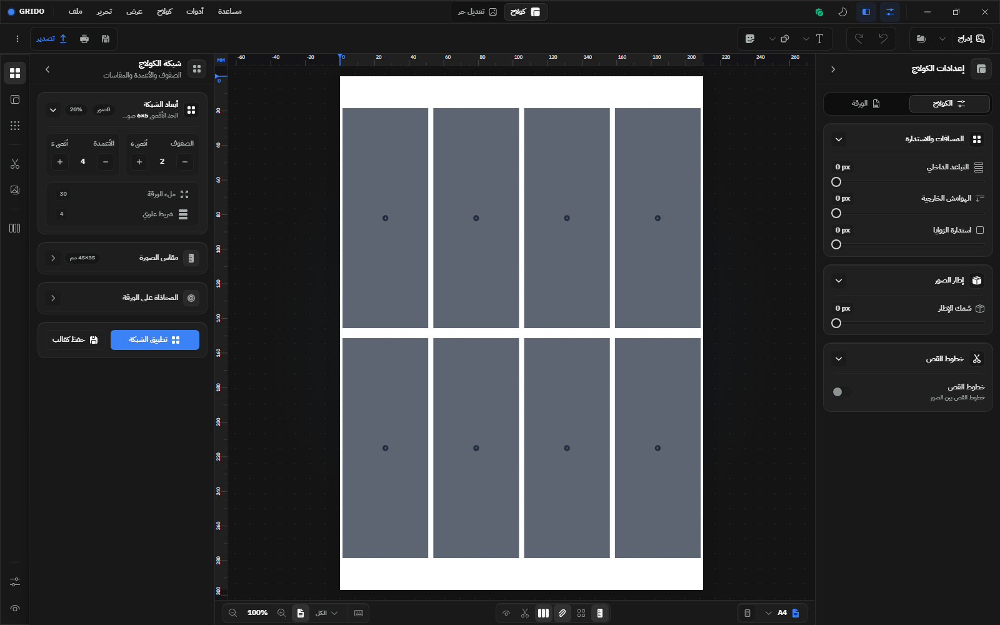
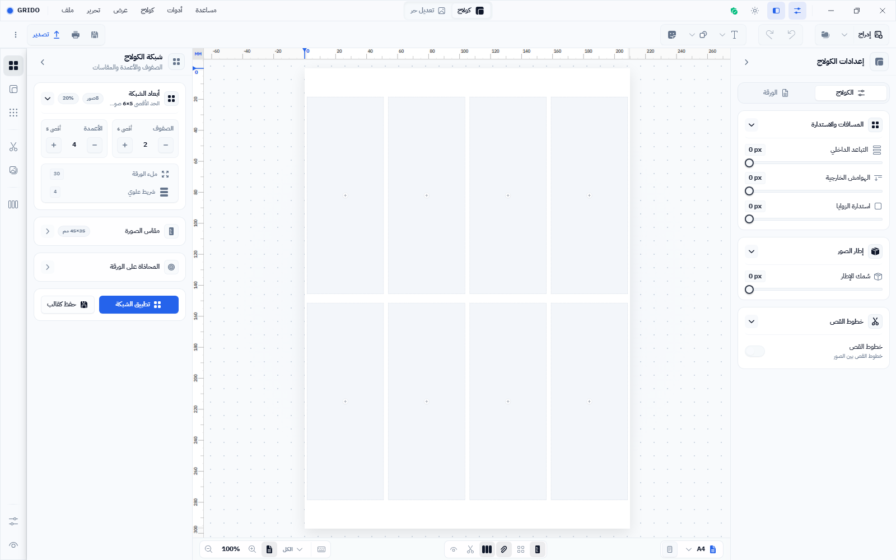
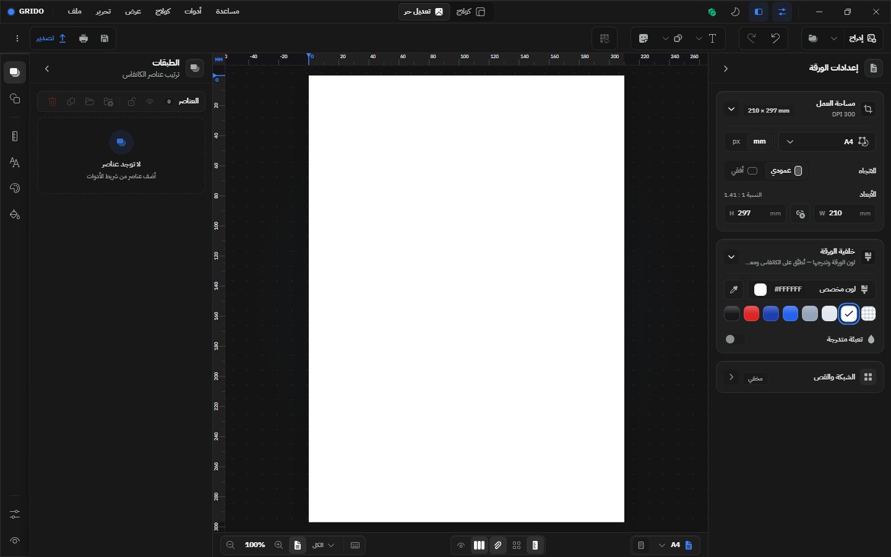
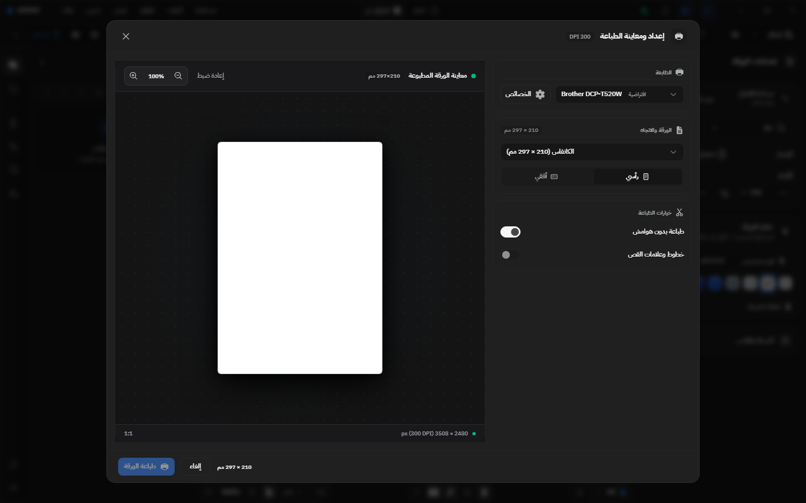
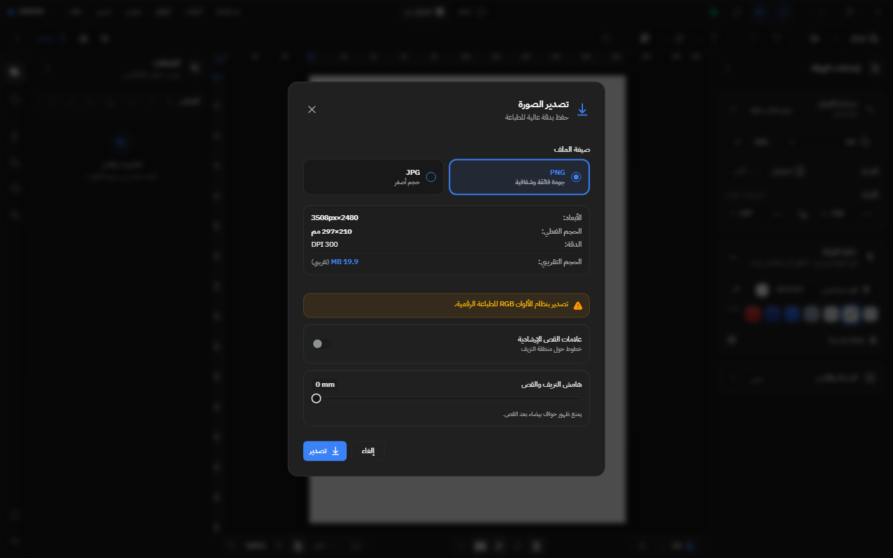
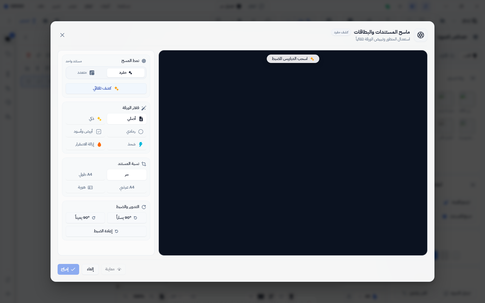

# تقييم بصري فعلي (لقطات تشغيل حيّة) — Grido Studio

**التاريخ:** 10 أكتوبر 2026
**النطاق:** واجهة محرر سطح المكتب (`frontend/src`) — الغلاف، الوضعان (كولاج/تحرير حر)، وحوارات الطباعة والتصدير والماسح.
**المنهج:** تشغيل واجهة React الحقيقية على خادم Vite في وضع التطوير، مع **محاكي Wails v3 نفسه** الذي تستخدمه اختبارات E2E (بلا خلفية Go تُعرض شاشة القفل)، والالتقاط عبر Playwright/Chromium — وهو نفس محرك WebView2 الذي يُنشر به التطبيق على ويندوز.

> هذا التقرير **تكميلي** للتقارير 4 و5 و13: تلك قيّمت الواجهة بقراءة الكود؛ هذا التقرير يتحقق من النتيجة على الشاشة فعلاً.
> كل اللقطات في [`assets/ui-audit-2026-10-10/`](./assets/ui-audit-2026-10-10/).

---

## 1. جرد اللقطات (22 صورة)

| المجموعة | المقاسات / الأوضاع |
|---|---|
| إقلاع كولاج | 1024 · 1280 · 1440 · 1600 × (داكن + مضيء) |
| الوضع الحر (single) | 1024 · 1440 · 1600 × (داكن + مضيء) |
| حوار الطباعة | 1440 × (داكن + مضيء) |
| حوار التصدير | 1440 × (داكن + مضيء) |
| حوار الماسح | 1440 × (داكن + مضيء) |
| كولاج بمحتوى مُدرج | 1440 × (داكن + مضيء) |

عينات بارزة:
`startup-dark-1600.png` · `startup-light-1600.png` · `single-dark-1440.png` · `single-light-1440.png` · `print-dark.png` · `export-dark.png` · `scanner-light.png`

---

## 2. الغلاف والاستجابة

- **عقد الاستجابة مؤكد بصرياً:** عند 1024 و1280 (حالة `standard`) يظهر شريط أيقوني يسار + **لوح واحد** يمين (~296px) ويبقى الكانفس ≥660px؛ وعند 1440 و1600 (حالة `wide`) يُضاف **درج القوالب الأيسر** بجانب مفتش الخصائص الأيمن. مطابق لـ `workspace-layout.tsx` تماماً.
- **الوضع المضيء** نظيف ومتوازن، وشبكة النقاط المنقطة تفصل الورقة عن مساحة العمل.
- **الحالة الفارغة** غير مُقحَمة (لا بطاقة تحجب الكانفس) — مطابق لعقد `canvas-empty-state`.

**ملاحظة دقيقة:** فصل الورقة البيضاء عن الخلفية المضيئة يعتمد على حدّ رقيق + شبكة نقاط فقط؛ التباين منخفض نسبياً (حافة A4 تتوهّم على خلفية شبه بيضاء).

## 3. RTL والثيمين

- **RTL سليم على مستوى المستند:** القوائم، عنوان النافذة، مبدّل الأوضاع المركزي، اللوحات، شريط الحالة — كلها مُنعكسة صحيحاً، بينما المساطر والأرقام بقيت **جزر LTR مقصودة**.
- **لا تسرّب ألوان خارج النظام:** كل الأسطح الداكنة فحمية متسقة (#141414/#1a1a1a/#242424) والمساطر مطابقة للثيم — يؤكد بصرياً أن تسرّب `slate/zinc` القديم (تدقيق سبتمبر) أُغلق فعلاً لا نظرياً.

## 4. الوضع الحر (single)

- اللوح الأيمن «إعدادات الورقة» منظّم على أقسام قابلة للطي (المقاس، الاتجاه، الأبعاد، خلفية الورقة، الشبكة/القص).
- اللوح الأيسر «الطبقات» بحالة فارغة مرشدة واضحة («لا توجد عناصر — أضف عناصر من شريط الأدوات»).
- إدراج صورة فعلية يُنجح ويعرض خصائص الصورة (قص/تدوير، عزل خلفية، ترميم، تأطير وجه، استدارة زوايا، مسح مستند).

## 5. حوار الطباعة

واجهة معاينة داكنة عالية الجودة، RTL كامل:
- رأس «إعداد ومعاينة الطباعة» + شارة `DPI 300`.
- منطقة معاينة بأدوات زوم (100%) وزر «إعادة ضبط» وقراءة «معاينة الورقة المطبوعة 297×210 مم».
- شريط سفلي: أبعاد `3508 × 2480 px (300 DPI)` و`1:1` + إجراء `طباعة الورقة` وإغلاق.
- الجانب: اختيار الطابعة + الخصائص، اتجاه رأسي/أفقي، ومفاتيح «طباعة بدون هوامش» و«خطوط وعلامات القص».

## 6. حوار التصدير

- رأس «تصدير الصورة — حفظ بدقة عالية للطباعة».
- تنسيقان كبطاقتين كبيرتين: PNG (محدَّد) / JPG.
- ملخص الدقة: الأبعاد، الحجم الفعلي، DPI، الحجم التقريبي.
- تنبيه كهرماني مقصود: «تصدير بنظام الألوان RGB للطباعة الرقمية» — إشارة صحيحة لا خطأ.
- خيارات: «علامات القص الإضافية» ومُنزلق «هامش القص».

## 7. حوار الماسح

- الرأس: «ماسح المستندات والبطاقات» + شارة «كشف مفرد»، واللوحان مرتّبان (الأدوات يسار، المعاينة يمين في RTL).
- الأدوات: نمط المسح (مفرد/متعدد + كشف تلقائي)، فلاتر الورقة (أصلي/ذكي + رمادي/أبيض وأسود/تشبع/إزالة الاصفرار)، نسبة المستند (حر/A4 طويل/A4 عرضي/هوية)، التدوير والضبط (90° يسار/يمين/إعادة ضبط).
- الشريط السفلي: `إدراج` (رئيسي) · `إلغاء` · `معاينة`.

> **قيد:** قماش المعاينة يبدو فارغاً/داكناً لأن عمليات OpenCV WASM لا تعمل في بيئة المحاكي — فلم تُرسم صورة المستند ولا مقابض الأركان. **الغلاف والأدوات مُتحقَّق منها بصرياً؛ تصيير المستند داخل القماش لم يُتحقق منه.**

---

## 8. الدرجات المحدَّثة

| المحور | الدرجة | دليل اللقطة |
|---|---|---|
| الغلاف والاستجابة | 9.5/10 | `startup-*` (4 عروض) |
| نظام الألوان والثيمين | 9.5/10 | `startup-dark/light-1600` |
| RTL | 9.5/10 | جميع اللقطات |
| الوضع الحر (محرر) | 9/10 | `single-*` |
| حوار الطباعة | 9.5/10 | `print-dark/light` |
| حوار التصدير | 9/10 | `export-dark/light` |
| حوار الماسح (الغلاف/الأدوات) | 8.5/10 | `scanner-*` (القماش غير محقَّق) |
| الوصولية (a11y) | 7.5/10 | انظر أدناه |
| **الإجمالي** | **9/10** | — |

**ما يمنع العشرة (ثابت كما في تقييم الكود):**
1. **الوصولية** — كثافة شريط الحالة السفلي (~10 أزرار مجهرية 24–28px) تظهر بصرياً، مع اعتماد كثير من الأزرار على Tooltip فقط بلا اسم برمجي.
2. **تباين فصل الورقة** في الوضع المضيء منخفض نسبياً.
3. **الكثافة الطباعية** الدقيقة (نصوص 9.5–10px متكررة).

## 9. قيود منهجية

- لم تُشغَّل نافذة Wails الأصلية، فالشفافية الحقيقية (Mica/Acrylic) غير ممثَّلة لأن الصفحة شفافة في اللقطات.
- المحاكي يعيد صوراً بسيطة (SVG/PNG 1×1)، فبعض محتوى الكانفس والماسح لا يظهر.
- محرك العرض Chromium (نفس عائلة WebView2) — سلوك متقارب وليس مطابقة تامة لعناصر النظام الأصلية.
