# تقييم بصري فعلي (تشغيل حيّ) — Grido Studio

**التاريخ:** 6 نوفمبر 2026
**النطاق:** واجهة محرر سطح المكتب (`frontend/src`) — الوضعان (كولاج/تحرير حر)، الألواح، الحوارات، الثيمان، والاستجابة عند 1440/1280/1024/840.
**المنهج:** تشغيل واجهة React الحقيقية على Vite مع محاكي Wails v3 نفسه المستخدم في اختبارات E2E، والالتقاط عبر Playwright/Chromium — نفس عائلة محرك WebView2 الذي يُنشر به التطبيق على ويندوز. كل الأحكام البصرية أدناه مبنية على لقطات مستقرة وقياسات DOM محسوبة، لا على قراءة الكود وحدها.

> **الحكم النهائي:** **8.8/10** — لا توجد عيوب `P0`. توجد **3 عيوب P1** (قفزة تخطيط 1024، تباين أزرار الإجراء الأساسية، أحجام أهداف اللمس)، و**3 عيوب P2**، و**5 ملاحظات P3**. الهوية البصرية والثيمان واستوديو الملصقات في مستوى ناضج فعلاً؛ أكبر تراجع منذ تقرير 17 هو عقد الاستجابة عند 1024.

> **اللقطات:** [`assets/ui-audit-2026-11-06/`](./assets/ui-audit-2026-11-06/) — 25 لقطة منتقاة + ملف القياسات [`metrics-dark-final.json`](./assets/ui-audit-2026-11-06/metrics-dark-final.json).
> **لا تغييرات إنتاجية:** هذا التقرير تشخيصي فقط؛ لم يُعدَّل أي ملف في `src` أو `backend`.

---

## 1. المنهجية وما تم قياسه

- **الالتقاط:** 45+ لقطة خام، منها 25 لقطة منتقاة تغطي الوضع الداكن والفاتح، الكولاج والتحرير الحر، لوحات الأشكال/النصوص/الملصقات/الطبقات، القوالب والورق والقص، الإعدادات، الحساب، لوحة الأوامر، التصدير، الطباعة، معرض الملصقات، المشاريع، والاستجابة عند 1440/1280/1024/840.
- **الثيم الداكن:** أُجبر عبر حدث `grido:toggle-theme` بعد الإقلاع، لأن Playwright يقلع بـ`prefers-color-scheme: light`؛ ثم أُعيد التحقق من `document.documentElement.classList.contains('dark')` قبل كل قياس.
- **الاستقرار:** فُصلت اللقطات النهائية عن لحظات الفتح/الإغلاق (انتظار ≥350ms أو تعطيل الحركات)، بعد أن أثبت التشخيص أن بعض اللقطات الأولى كانت تلتقط `skeleton` أو شفافية أثناء `fade-in` وليست عيوباً دائمة.
- **القياسات:** `getBoundingClientRect` للألواح والكانفس، `getComputedStyle` للأسطح والتوكنات والخطوط، حساب تباين WCAG، مسح أهداف اللمس `<24×24`، عدّ العناصر القابلة للتركيز، فحص التجاوز الأفقي، وقياس `activeElement` + `outline` بعد فتح الحوارات.
- **القيود:** لم تُشغَّل نافذة Wails الأصلية (شفافية Mica غير ممثَّلة)؛ لا خلفية Go ولا OpenCV WASM (محتوى الماسح داخل القماش غير محقَّق)؛ الحركات معطّلة في اللقطات؛ القياس على `deviceScaleFactor = 1` فقط (لا 125%/150%)؛ Chromium سلوك متقارب وليس مطابقة تامة لـWebView2.

---

## 2. الملخص التنفيذي

Grido Studio يبدو كمنتج مصقول لا كنموذج أولي: أسطح فحمية متسقة، RTL أصيل، كثافة معلومات مدروسة، واستوديو ملصقات هو أقوى سطح بصري في التطبيق. الحوارات (التصدير/الطباعة/الحساب) واضحة الهيكل، والثيم الفاتح ليس مجرد عكس آلي — له تباينه وقواعده.

لكن هناك ثلاث فجوات تمنع درجة أعلى:

1. **عند 1024px ينهار مساحة الكانفس إلى 404px** لأن اللوحين (288+288) يبقيان مفتوحين، بينما عند 1023px يتحول التخطيط إلى وضع مضغوط بعرض كامل. قفزة 619px في بكسل واحد من عرض النافذة.
2. **أزرار الإجراء الأساسية** التي تستخدم `bg-primary` (مثل «طباعة الورقة» و«إضافة») تظهر بـ`#3b82f6` مع نص أبيض = **3.67:1**، أقل من AA (4.5:1) للنص الصغير — بينما «تصدير» و«تطبيق الشبكة» يستخدمان `--primary-action: #2563eb` = **5.17:1** وينجحان. المشكلة في توكن غير موحّد، لا في التصميم.
3. **17 هدفاً تفاعلياً أصغر من 24×24** في الحالة الافتراضية عند 1280/1024، أبرزها شبكة المحاذاة التسعة بمقاس 17×17.

### جدول الدرجات (موزون)

| المحور | الوزن | الدرجة | الأساس |
|---|---:|---:|---|
| الهوية البصرية والثيمان | 15% | 9.5 | أسطح متسقة، لا تسرّب ألوان، ثيم فاتح مكتمل |
| التخطيط والاستجابة | 15% | 8.0 | قفزة 1024 والكانفس 39.5% |
| RTL والتوطين | 10% | 9.3 | RTL أصيل؛ أرقام هندية في المشاريع |
| الكولاج والورق | 10% | 9.0 | أدوات غنية؛ الحالة الافتراضية شبه فارغة |
| التحرير الحر والخصائص | 10% | 9.4 | كثافة منظمة وقابلة للمسح |
| الحوارات | 10% | 9.3 | تصدير/طباعة/حساب ممتازة؛ إطار تركيز عابر |
| استوديو الملصقات | 10% | 9.5 | أفضل سطح بصري في التطبيق |
| الوصولية والتفاعل | 15% | 7.5 | تباين 3.67 وأهداف <24px |
| الاتساق الطباعي | 5% | 8.8 | 8px متكررة في المساطر والبيانات الوصفية |
| **الإجمالي** | **100%** | **8.84 ≈ 8.8** | — |

---

## 3. نقاط القوة

### 3.1 هوية داكنة ناضجة بلا تسرّب ألوان

قياس الأسطح في 1280: الألواح والشريط والهيدر والفوتر كلها `rgba(26,26,26,0.84)`، والكانفس `rgba(20,20,20,0.78)`، وبطاقة الحوار `#202020`. لا توجد أسطح فاتحة شاذة في الوضع الداكن، ولا ألوان `slate/zinc` متبقية. النتيجة: عمق بصري هادئ بلا ضجيج، والورقة البيضاء تبقى هي البطل.

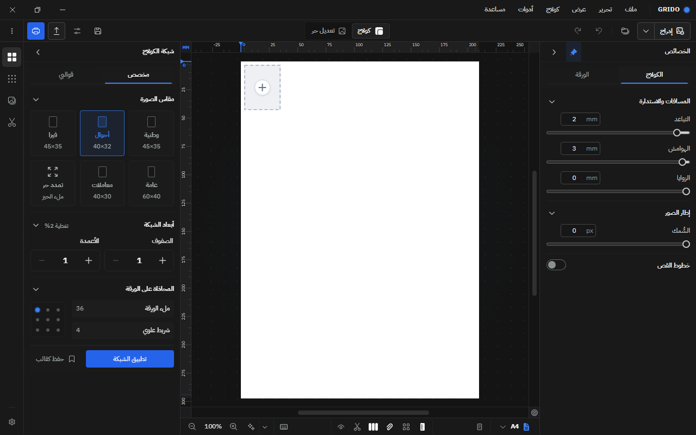

### 3.2 RTL أصيل، لا مجرد انعكاس

القوائم والألواح وشريط الحالة والمساطر كلها في الاتجاه الصحيح، بينما المساطر والأرقام بقيت جزر LTR مقصودة. لا نص مقلوب ولا أيقونة معكوسة الدلالة. حتى تدرّج الظلال والفواصل يحترم اتجاه القراءة.

### 3.3 استوديو الملصقات: أقوى سطح بصري

المعرض يعرض البطاقات بظلال ناعمة وتصنيفات واضحة (إطارات/أختام/غراض)، وشاشة التخصيص تجمع النص والألوان والمحاذاة والمعاينة الحية في مساحة واحدة مفهومة. هذا هو المكان الذي يبدو فيه التطبيق أقرب إلى أداة تصميم احترافية.

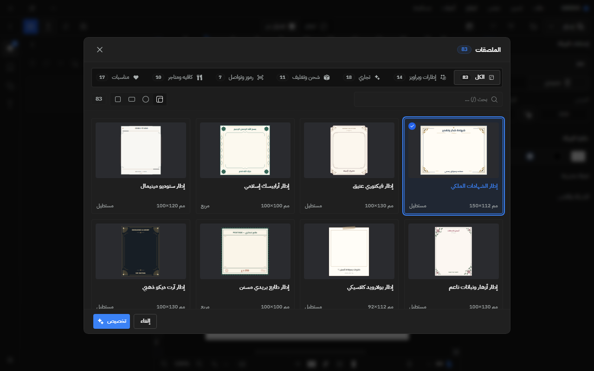

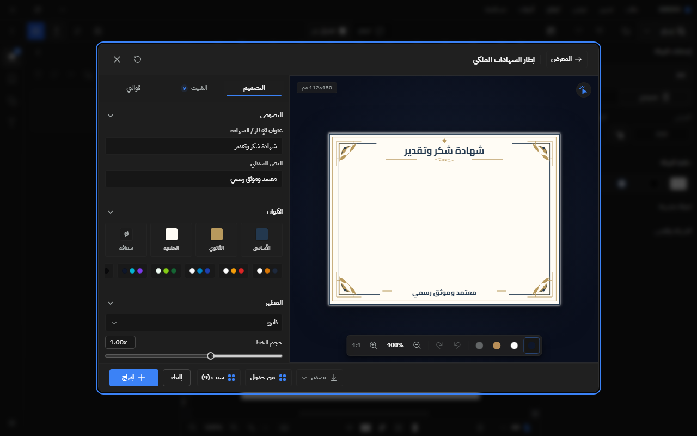

### 3.4 حوارات واضحة الهيكل

التصدير يعرض تسلسلاً صحيحاً: الألوان → الصيغة → الملخص → الخيارات → الإجراء. الطباعة تعرض معاينة كبيرة + لوحة إعدادات جانبية + شريط حالة سفلي للمقاس وDPI. الحساب يعرض حالة الترخيص في بطاقة خضراء واضحة مع مفتاح التنشيط وإجراء النسخ.

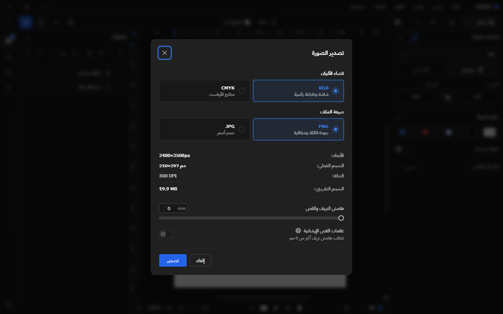

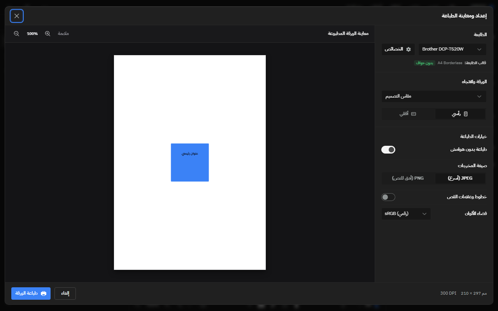

### 3.5 تكافؤ الثيم الفاتح

الثيم الفاتح ليس نسخة باهتة: نفس التسلسل البصري، نفس التباعد، ونفس وضوح الحوارات. لقطة التصدير المستقرة ولقطة الحساب تؤكدان أن الفاتح حالة مصممة لا حالة عرضية.

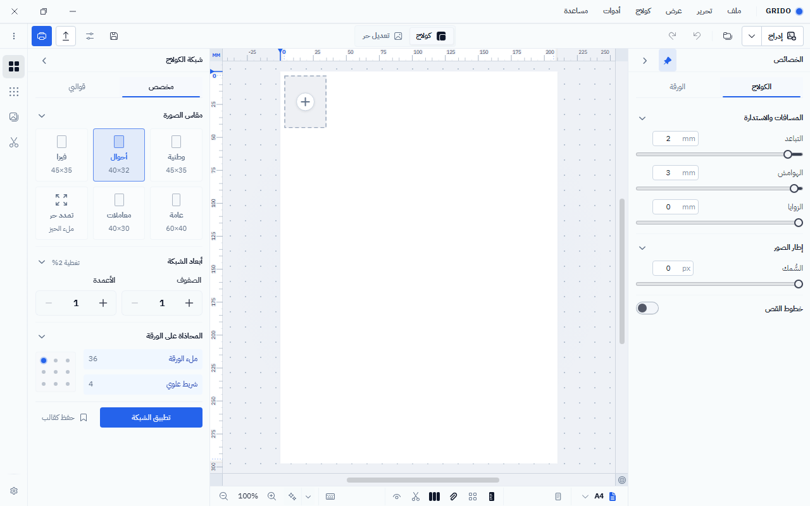

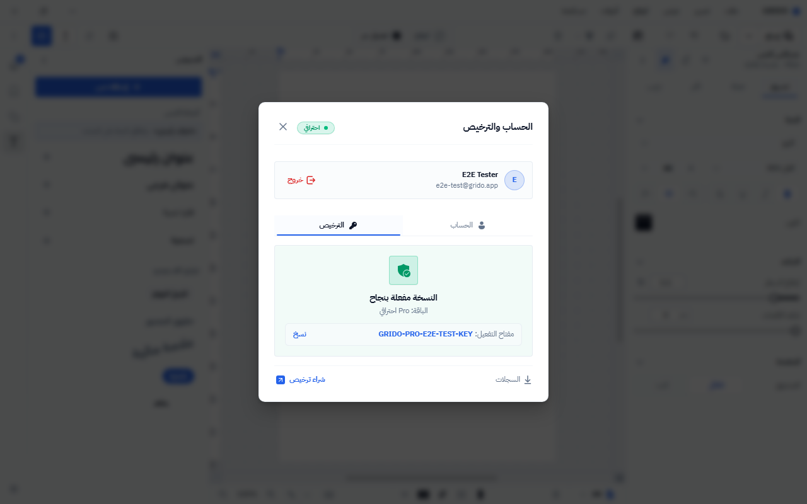

### 3.6 الكولاج والورق: عمق أدوات مع تنظيم

تبويبات «قوالب/مخصص»، مقاسات الصورة، أبعاد الشبكة، المحاذاة، الورق والقص، وأوضاع النسخ — كلها في لوح واحد بترتيب منطقي. حالة «لا توجد قوالب محفوظة» واضحة وتقدّم إجراء استيراد JSON بدل فراغ ميت.

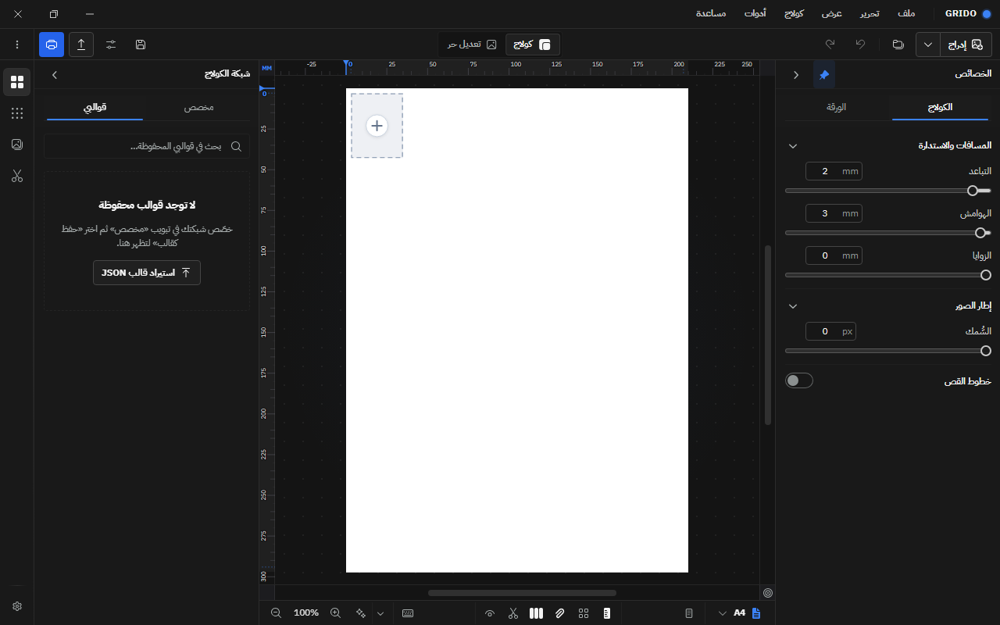

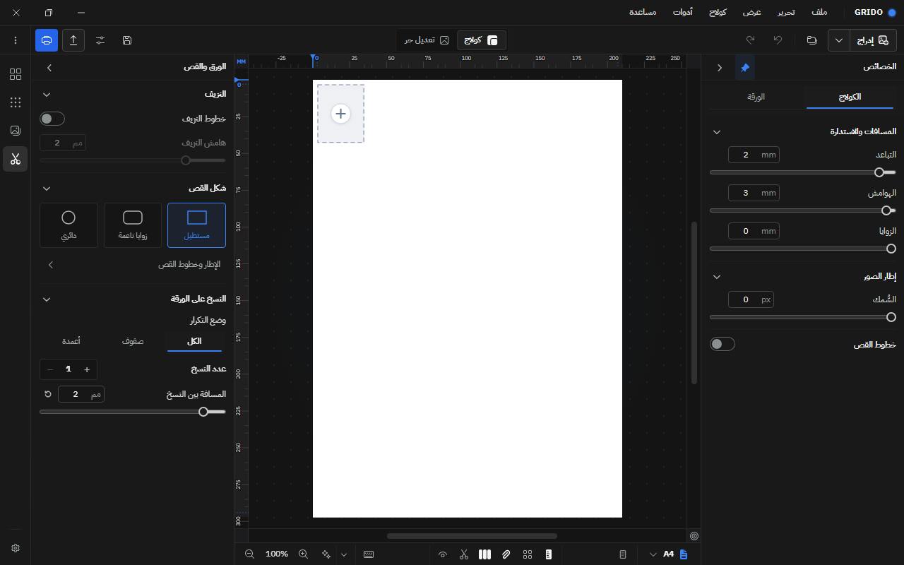

### 3.7 الوضع الواسع 1440 هو الأفضل

عند 1440 يظهر الشريط (44px) + لوح القوالب (288px) + كانفس 820px (56.9%) + لوح الخصائص (288px). هذا هو التوازن الصحيح: مساحة عمل أكبر من مجموع اللوحين، وكثافة معلومات مبررة.

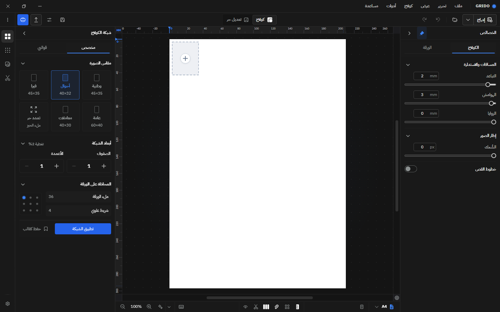

---

## 4. العيوب مرتبة حسب الشدة

### P1 — عيوب تستحق إصلاحاً قريباً

#### P1-01 · قفزة استجابة حادة عند 1024px

**الدليل المقاس:**

| عرض النافذة | الشريط | القوالب | الكانفس | الخصائص | نسبة الكانفس |
|---:|---:|---:|---:|---:|---:|
| 1440 | 44 | 288 | **820** | 288 | 56.9% |
| 1280 | 44 | 288 | **660** | 288 | 51.6% |
| 1024 | 44 | 288 | **404** | 288 | **39.5%** |
| 1023 | — | — | **1023** | — | 100% |
| 840 | — | — | **840** | — | 100% |

عند 1024px يبقى اللوحان مفتوحين (لأن الحد الفاصل `compact` هو `<1024`)، فيصبح الكانفس أصغر من مجموع اللوحين (404 مقابل 576). عند 1023px يتحول التطبيق إلى الوضع المضغوط ويعود الكانفس بعرض النافذة كاملاً. **الفارق 619px مقابل تغيير 1px في العرض** — وهذا ليس استجابة سلسة، بل انقطاع.

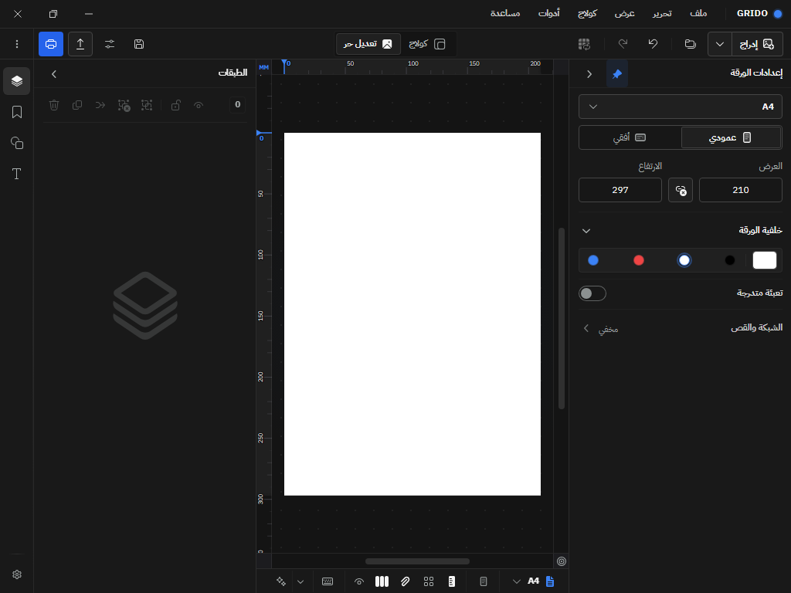

**السبب في الكود:** `use-workspace-panels.ts` يعرّف `compact` عند `<1024` و`standard` حتى `<1440`، بينما الافتراضيات `isTemplatesDrawerOpen = true` و`isInspectorPinned = true` تفتح اللوحين معاً في كل عروض سطح المكتب. تقرير 17 كان يوثّق عقد «لوح واحد عند 1024/1280 وكانفس ≥660px»؛ التطبيق الحالي يخالف هذا العقد عند 1024.

**التوصية:** في نطاق `standard` (1024–1439) افتح لوح الخصائص فقط افتراضياً وأبقِ درج القوالب مطوياً وقابلاً للفتح بضغطة، أو ارفع حد `compact` إلى 1152/1200. لا تمسّ سلوك 1280/1440. أضف اختبار انحدار عند 1024 و1280 يؤكد `canvasWidth ≥ 560` (أو وجود لوح واحد فقط). إن كان فتح اللوحين مطلباً للمالك، فالحل البديل هو تصغير اللوحين إلى 248px عند 1024–1151 فقط.

#### P1-02 · تباين أزرار الإجراء الأساسية 3.67:1

**القياس:** `--primary` في الثيم الداكن = `#3b82f6`، والنص أبيض `#ffffff` ⇒ **3.67:1**. هذا أقل من 4.5:1 المطلوب للنص العادي (11.5–12px). أمثلة ظاهرة: زر «طباعة الورقة» في حوار الطباعة (#3b82f6)، وزر «إضافة» في استوديو الملصقات (#3b82f6). وعند قياس البكسل نفسه في الثيم الفاتح، زر «إضافة» يستخدم `#2563eb` — أي أن المشكلة خاصة بتوكن الثيم الداكن.

في المقابل، زر «تصدير» في الحوار وزر «تطبيق الشبكة» في لوح الكولاج يستخدمان `--primary-action: #2563eb` ويعطيان **5.17:1** — أي أن النظام يملك بالفعل التوكن الصحيح، لكن أزرار `bg-primary` لا تستخدمه.

**التوصية:** في الثيم الداكن وحّد `--primary` مع `--primary-action` (`#2563eb`)، أو استخدم `#1d4ed8` إن أردت هامشاً أكبر (≈6.3:1)، أو استبدل `bg-primary` بـ`bg-primary-action` في أزرار تأكيد الحوارات. أعد قياس كل حالات hover/active. هذا تغيير توكن/فئة واحد، لا إعادة تصميم.

#### P1-03 · 17 هدفاً تفاعلياً أصغر من 24×24

**القياس عند 1280 و1024 (الحالة الافتراضية):** 17 عنصراً ظاهراً أصغر من 24×24:

| العنصر | المقاس | العدد |
|---|---:|---:|
| شبكة المحاذاة (أعلى/وسط/أسفل × يسار/وسط/يمين) | 17×17 | 9 |
| إعادة توسيط الكانفس | 18×18 | 1 |
| خيارات وحدة قياس المسطرة | 20×20 | 1 |
| أوضاع ملاءمة الورقة | 21×28 | 1 |
| حقول القيم (تباعد/هوامش/زوايا/سُمك) | 36×18 | 4 |
| مفتاح «إظهار خطوط القص» | 36×20 | 1 |

ويضاف إليها في وضع التحرير **5 أزرار طبقات 23×23** (أحضار للأمام/إرسال للخلف/تدوير/قلب/إغلاق الشريط). عند 840 ينخفض العدد إلى 3 فقط لأن الألواح مغلقة.

**لماذا P1:** هذا يخالف WCAG 2.2 SC 2.5.8 (الحد الأدنى 24×24) في عناصر متكررة الاستخدام، وليس في زر نادر. شبكة المحاذاة تحديداً تُستخدم بالنقر الدقيق، و17×17 مساحة صغيرة حتى مع الفأرة.

**التوصية:** لا تكبّر الأيقونة بصرياً؛ أضف مساحة نقر غير مرئية (padding أو `::before` ممتد) إلى 24×24 على الأقل. شبكة المحاذاة يمكن جمعها في زر واحد يفتح شبكة 32px، وحقول القيم ترفع إلى ارتفاع 24. أضف فحصاً آلياً يمنع أي هدف `<24` في المكونات الأساسية.

---

### P2 — عيوب ملحوظة في الصقل والاتساق

#### P2-01 · إطار تركيز أزرق حول الحوار كاملاً

**الدليل:** بعد اختيار قالب من «القوالب» في استوديو الملصقات، ينتقل التركيز إلى حاوية الحوار (`activeElement` = `div[role="dialog"][data-slot="dialog-content"]`)، فتلتقط القاعدة العامة `[tabindex]:focus-visible` الإطار:

```css
outline: 2px solid rgb(59, 130, 246);
outline-offset: 2px;
```

النتيجة: إطار أزرق يحيط بالحوار كأنه عنصر محدد، لا زر. يظهر بوضوح في لقطة التخصيص.

**التوصية:** استثنِ `tabindex="-1"` من قاعدة التركيز:

```css
[tabindex]:not([tabindex="-1"]):focus-visible { ... }
```

أو أضف `focus-visible:outline-none` إلى `DialogContent` مع نقل التركيز إلى أول حقل/زر فعلي عند الفتح. هذا يحافظ على مؤشر لوحة المفاتيح حيث يجب، ويزيل الإطار المضلل.

#### P2-02 · أرضية طباعية منخفضة: 8px متكررة

**القياس عند 1280:** من أصل 83 عقدة نصية ظاهرة، هناك **24 عقدة عند 8px** (كلها تسميات مساطر + وحدة `mm`) و**2 عند 9px**. الواجهة الأساسية عند 11–12px (37 عقدة 11.5px، 11 عقدة 12px). عند 840 يرتفع عدد 8px إلى 28 عقدة.

تسميات المساطر قد تكون استثناءً مشروعاً في أدوات التصميم، لكن 8px هو 30% أصغر من متن الواجهة، ويظهر أيضاً في بيانات المعرض الوصفية (9px تقريباً). النتيجة: بعض المعلومات تُقرأ بالتكبير لا بالنظرة.

**التوصية:** ارفع تسميات المساطر إلى 9px كحد أدنى، وبيانات المعرض إلى 10px، مع ضبط التباعد لتفادي التزاحم. لا ترفع كل شيء؛ استخدم الوزن واللون للهرمية بدل الانزلاق إلى 8px.

#### P2-03 · الحالة الفارغة للطبقات أيقونية فقط

لوح «الطبقات» الفارغ يعرض أيقونة كبيرة باهتة (5×) بلا نص، اعتماداً على Tooltip. هذا متسق مع فلسفة «صفر حشو بصري»، لكنه يضعف الاكتشاف: المستخدم الجديد لا يعرف أن اللوح يعمل، ولا أن العناصر تُضاف من اللوح المقابل.

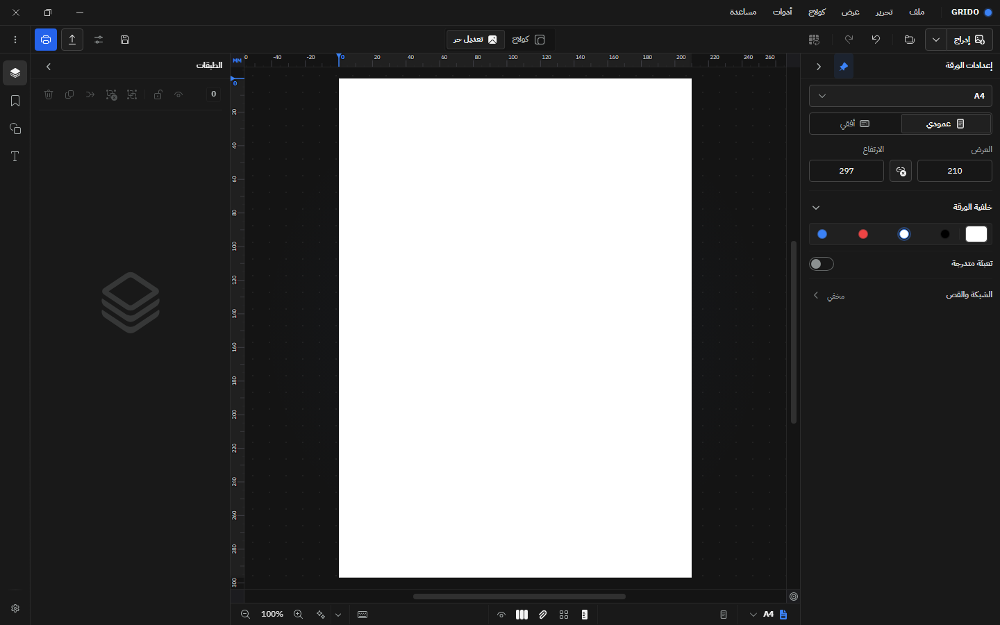

**التوصية:** سطر واحد فقط تحت الأيقونة: «لا توجد عناصر بعد — أضف شكلاً أو نصاً من اللوح اليسرى». يختفي بعد أول عنصر. هذا استثناء مبرر لقاعدة صفر الحشو لأنه يخدم التعلّم الأول.

---

### P3 — ملاحظات صغيرة أو حالات طرفية

#### P3-01 · أرقام هندية في تاريخ المشاريع

في حوار «مكتبة المشاريع» يظهر التاريخ `٢٠٢٦/١١/٠٦` بالأرقام العربية-الهندية، بينما بقية الواجهة (المساطر، الأبعاد، DPI، الأسعار) تستخدم الأرقام الغربية. هذا يكسر الاتساق البصري ويصعّب المقارنة السريعة.

**التوصية:** استخدم `Intl.DateTimeFormat('ar-SA-u-nu-latn')` أو تنسيقاً موحداً بالأرقام الغربية، أو اعتمد الأرقام الهندية في كل الواجهة — لكن ليس الاثنين معاً.

#### P3-02 · مفتاح التبديل «المفعّل» محايد أبيض/أسود

المفتاح عند التفعيل يستخدم مساراً أبيض/أسود بدل لون التمييز الأزرق (مثل «طباعة بدون هوامش» في حوار الطباعة). قد يُقرأ خطأً كأنه مغلق، خصوصاً في الثيم الداكن.

**التوصية:** استخدم `--primary` عند التفعيل (أو علامة صح داخل المقبض)، مع الحفاظ على تباين 3:1 على الأقل بين المقبض والمسار.

#### P3-03 · الحالة الافتراضية للكولاج شبه فارغة

الخلية الافتراضية 1×1 بمقاس 40×32 في أعلى يسار ورقة A4، ما يجعل أغلب الورقة فارغاً. وجود علامة «+» داخل الخلية يخفف الغموض، لكنه لا يشرح العلاقة بين لوح الصورة والورقة.

**التوصية:** ضع الخلية الأولى في المنتصف بصرياً، أو أضف تلميحاً واحداً «اسحب صورة إلى الخلية أو اختر مقاساً» يختفي بعد أول إدراج. لا تضف بطاقة onboarding كبيرة تحجب الورقة.

#### P3-04 · هيكل تحميل عابر عند أول فتح للتصدير

أول فتح لحوار التصدير بعد إقلاع بارد يعرض `skeleton` لجزء من الثانية قبل المحتوى المستقر. هذا ليس خللاً دائماً (اللقطة المستقرة سليمة)، لكنه قفزة بصرية ملحوظة في أول تفاعل.

**التوصية:** سخّن حزمة الحوار (preload) بعد جاهزية المحرر، أو أبقِ الحوار mounted مخفياً، أو استبدل الـskeleton بعنصر نائب بهيكل ثابت يطابق الحجم النهائي.

#### P3-05 · ورقة A4 بيضاء نقية داخل غلاف شبه أسود

التباين قوي ومقصود لدقة الطباعة، لكنه قد يسبب إجهاداً في جلسات طويلة. هذا اختيار تصميمي لا عيب وظيفي.

**التوصية (اختيارية):** أضف خيار «تعتيم الورقة للمعاينة فقط» يخفض سطوع الورقة دون التأثير على التصدير/الطباعة. لا تفعّله افتراضياً.

---

## 5. ما نُفي بالقياس (فرضيات لم تثبت)

| الفرضية | النتيجة المقاسة |
|---|---|
| «اللوح الأيسر فاتح في الثيم الداكن» | **غير صحيح** — `rgba(26,26,26,0.84)` لكل الألواح والشريط والهيدر والفوتر |
| «حوار التصدير الفاتح معطوب دائماً» | **غير صحيح** — اللقطة الأولى التقطت `skeleton` عابراً؛ الحالة المستقرة سليمة وواضحة |
| «قائمة الإعدادات فاتحة» | **غير صحيح** — داكنة ومتسقة مع الأسطح |
| «تعارض في لون النص المحدد» | **غير صحيح** — `fill` النص `#0f172a`، والإطار الأبيض مجرد تحديد؛ الشكل الأزرق خلفية مستقلة |
| «وضع 1024 هجين» | **غير صحيح** — إنه `standard` بكلا اللوحين، وليس مزيجاً |
| «يوجد تجاوز أفقي» | **غير صحيح** — `documentOverflow = 0` عند 1280/1024/840 |
| «أزرار بلا اسم» | **0** — كل الأزرار الظاهرة لها اسم أو Tooltip |
| «نص مقصوص» | **0** في العينات المفحوصة |

هذه الجولة أكدت قيمة الفصل بين «لقطة أثناء الحركة» و«لقطة مستقرة»: ثلاث لقطات أولى كانت مضللة، وثلاث حالات أُعيد تصويرها بعد الانتظار فأثبتت سلامتها.

---

## 6. جدول القياسات الكامل

### 6.1 التخطيط

| العرض | الحالة | الشريط | القوالب | الخصائص | الكانفس | الهيدر/الفوتر |
|---:|---|---:|---:|---:|---:|---:|
| 1440 | wide | 44 | 288 | 288 | **820** | 37 / 32 |
| 1280 | standard | 44 | 288 | 288 | **660** | 37 / 32 |
| 1024 | standard | 44 | 288 | 288 | **404** | 37 / 32 |
| 1023 | compact | — | — | — | **1023** | 37 / 32 |
| 840 | compact | — | — | — | **840** | 37 / 32 |

> عند 840 لا يُركَّب شريط الأدوات الجانبي ولا اللوحان؛ يظهر زر «المشغّل السريع» العائم أسفل يسار الكانفس. هذا هو أنظف تخطيط في التطبيق.
> اللوح الأيسر في لقطة 1024 هو «الطبقات» لأن الوضع تحرير حر؛ القياس في الجدول على الحالة الافتراضية «القوالب». كلاهما بعرض 288px، والنتيجة واحدة.

### 6.2 الطباعة والأهداف

| القياس | 1280 | 1024 | 840 |
|---|---:|---:|---:|
| أهداف `<24×24` | 17 | 17 | 3 |
| عناصر قابلة للتركيز (ظاهرة) | 85 | 85 | 39 |
| تجاوز أفقي (px) | 0 | 0 | 0 |
| أحجام الخط | 11.5 (37) · 12 (11) · 11 (7) · 13.5 (2) · 8 (24) · 9 (2) | — | 11.5 (14) · 12 (1) · 8 (28) · 9 (2) |

### 6.3 الألوان والتباين

| العنصر | القيمة | التباين |
|---|---|---:|
| `--primary` (داكن) | `#3b82f6` | **3.67:1** مع الأبيض |
| `--primary-action` (داكن) | `#2563eb` | **5.17:1** مع الأبيض |
| سطح اللوحات/الشريط/الهيدر | `rgba(26,26,26,0.84)` | — |
| سطح الكانفس | `rgba(20,20,20,0.78)` | — |
| بطاقة الحوار | `#202020` | — |

### 6.4 التركيز داخل الحوار

| القياس | القيمة |
|---|---|
| العنصر النشط بعد اختيار قالب | `DIV[role="dialog"][data-slot="dialog-content"]` |
| `outline-style` | `solid` |
| `outline-width` | `2px` |
| `outline-color` | `rgb(59, 130, 246)` |
| `outline-offset` | `2px` |

---

## 7. ملاحظات الشاشات

| الشاشة | الحكم | الملاحظة الأبرز |
|---|---|---|
| الكولاج الافتراضي (01) | 9.0 | هوية قوية؛ الورقة شبه فارغة والخلية 40×32 في الزاوية |
| التحرير الحر (02) | 9.2 | ورقة ممركزة ولوح طبقات هادئ؛ الحالة الفارغة أيقونية فقط |
| الأشكال (03) | 9.3 | 33 شكلاً في ثلاث مجموعات، أيقونات متسقة |
| النصوص (06) | 9.2 | كثافة خصائص عالية لكنها مقسمة بعناوين واضحة |
| الملصقات (07) | 9.5 | بطاقات المعرض بظلال ناعمة وتصنيفات مفهومة |
| الطبقات (08) | 9.0 | صفوف واضحة؛ أزرار الصف 23×23 صغيرة |
| الإعدادات (09) | 9.0 | داكنة ومتسقة؛ مركز أوامر كثيف لكنه منظم |
| الحساب (10) | 9.3 | بطاقة ترخيص خضراء واضحة؛ إطار تركيز أزرق على زر الإغلاق عند الفتح |
| لوحة الأوامر (11) | 9.4 | بحث + اختصارات + مجموعات، بلا ضجيج |
| التصدير (12) | 9.3 | تسلسل ممتاز؛ زر التصدير 5.17:1 |
| الطباعة (13) | 9.5 | معاينة كبيرة + إعدادات جانبية + شريط DPI |
| معرض الملصقات (14) | 9.5 | أفضل سطح بصري |
| تخصيص الملصق (15) | 9.2 | تخطيط ممتاز؛ إطار الحوار الأزرق هو العيب |
| المشاريع (16) | 9.1 | مستقر وداكن؛ التاريخ بالأرقام الهندية |
| شبكة الكولاج (17) | 9.2 | كثافة مبررة وأدوات واضحة |
| الكولاج الفاتح (21) | 9.4 | تكافؤ جيد؛ فصل الورقة يعتمد على ظل رقيق |
| الحساب الفاتح (24) | 9.3 | واضح ومتوازن |
| التصدير الفاتح (25) | 9.2 | مستقر وسليم بعد انتظار الحركة |
| منتقي اللون (29) | 9.3 | عجلة ألوان حية بلا قص أو تجاوز |
| الواسع 1440 (31) | 9.5 | أفضل توازن بين اللوحين والكانفس |
| الواسع تحرير (32) | 9.3 | الحالة الفارغة تحتاج سطراً إرشادياً |
| 1024 (33) | 7.5 | الكانفس 404px — المشكلة الأولى |
| 840 (34) | 9.2 | وضع مضغوط نظيف؛ 3 أهداف صغيرة فقط |
| قوالب الكولاج (41) | 9.2 | حالة فارغة واضحة مع استيراد JSON |
| الورق والقص (42) | 9.2 | تجميع منطقي وأوضاع نسخ مفهومة |

<details>
<summary><strong>جرد اللقطات الكامل (25 لقطة + القياسات)</strong></summary>

| # | اللقطة | الغرض |
|---|---|---|
| 01 | [الكولاج الداكن الافتراضي](./assets/ui-audit-2026-11-06/01-dark-collage-default-1280.png) | الهوية، اللوحان، الحالة الافتراضية |
| 02 | [التحرير الحر الفارغ](./assets/ui-audit-2026-11-06/02-dark-single-empty-1280.png) | الورقة الممركزة، لوح الطبقات |
| 03 | [لوح الأشكال](./assets/ui-audit-2026-11-06/03-dark-shapes-panel-1280.png) | 33 شكلاً في ثلاث مجموعات |
| 06 | [النص المحدد](./assets/ui-audit-2026-11-06/06-dark-text-selected-1280.png) | كثافة خصائص النص |
| 07 | [لوح الملصقات](./assets/ui-audit-2026-11-06/07-dark-stickers-panel-1280.png) | شبكة المعرض والتصنيفات |
| 08 | [الطبقات الممتلئة](./assets/ui-audit-2026-11-06/08-dark-layers-panel-1280.png) | صفوف الطبقات وأزرارها |
| 09 | [قائمة الإعدادات](./assets/ui-audit-2026-11-06/09-dark-settings-menu-1280.png) | مركز الحساب/المظهر/الاختصارات |
| 10 | [حوار الحساب](./assets/ui-audit-2026-11-06/10-dark-account-dialog-1280.png) | بطاقة الترخيص |
| 11 | [لوحة الأوامر](./assets/ui-audit-2026-11-06/11-dark-command-palette-1280.png) | البحث والاختصارات |
| 12 | [حوار التصدير](./assets/ui-audit-2026-11-06/12-dark-export-dialog-1280.png) | الألوان/الصيغة/الملخص |
| 13 | [حوار الطباعة](./assets/ui-audit-2026-11-06/13-dark-print-dialog-1280.png) | المعاينة والإعدادات |
| 14 | [معرض الملصقات](./assets/ui-audit-2026-11-06/14-dark-sticker-gallery-1280.png) | بطاقات المعرض |
| 15 | [تخصيص الملصق](./assets/ui-audit-2026-11-06/15-dark-sticker-customize-1280.png) | المعاينة الحية + إطار التركيز |
| 16 | [مكتبة المشاريع](./assets/ui-audit-2026-11-06/16-dark-projects-dialog-1280.png) | الحالة المستقرة والتاريخ |
| 17 | [شبكة الكولاج](./assets/ui-audit-2026-11-06/17-dark-collage-grid-1280.png) | تخصيص الشبكة |
| 21 | [الكولاج الفاتح](./assets/ui-audit-2026-11-06/21-light-collage-default-1280.png) | تكافؤ الثيم الفاتح |
| 24 | [الحساب الفاتح](./assets/ui-audit-2026-11-06/24-light-account-dialog-1280.png) | حوار فاتح |
| 25 | [التصدير الفاتح](./assets/ui-audit-2026-11-06/25-light-export-dialog-1280.png) | الحالة المستقرة |
| 29 | [منتقي اللون](./assets/ui-audit-2026-11-06/29-light-color-picker-1280.png) | عجلة الألوان |
| 31 | [الواسع 1440](./assets/ui-audit-2026-11-06/31-dark-wide-collage-1440.png) | أفضل توازن |
| 32 | [الواسع تحرير](./assets/ui-audit-2026-11-06/32-dark-wide-single-layers-1440.png) | الطبقات الفارغة |
| 33 | [1024](./assets/ui-audit-2026-11-06/33-dark-standard-single-1024.png) | الكانفس 404px |
| 34 | [840](./assets/ui-audit-2026-11-06/34-dark-compact-single-840.png) | الوضع المضغوط |
| 41 | [قوالب الكولاج](./assets/ui-audit-2026-11-06/41-dark-collage-presets-1280.png) | الحالة الفارغة |
| 42 | [الورق والقص](./assets/ui-audit-2026-11-06/42-dark-collage-paper-1280.png) | النسخ والقص |
| — | [القياسات الخام](./assets/ui-audit-2026-11-06/metrics-dark-final.json) | DOM/تباين/أهداف |

</details>

---

## 8. خطة الإصلاح المقترحة

### المرحلة 1 — P1 (1–2 أيام)

1. **1024:** في `standard` افتح لوح الخصائص فقط افتراضياً، أو ارفع `compact` إلى 1152. أضف اختبار انحدار عند 1024 و1280.
2. **التباين:** وحّد `--primary` مع `#2563eb` في الثيم الداكن. أعد قياس hover/active.
3. **الأهداف:** وسّع مساحات النقر إلى 24×24 دون تغيير الأحجام البصرية؛ اجمع شبكة المحاذاة في زر واحد إن أمكن.

### المرحلة 2 — P2 (يوم واحد)

4. استثنِ `[tabindex="-1"]` من قاعدة التركيز، أو عطّل الإطار على `DialogContent` مع نقل التركيز لأول حقل.
5. ارفع أرضية الخط: 9px للمساطر و10px للبيانات الوصفية.
6. أضف سطراً إرشادياً واحداً لحالة الطبقات الفارغة.

### المرحلة 3 — P3 (نصف يوم)

7. وحّد الأرقام في التواريخ.
8. اجعل المفتاح المفعّل يستخدم لون التمييز.
9. حسّن الحالة الافتراضية للكولاج (تلميح/توسيط الخلية).
10. عالج `skeleton` أول فتح للتصدير (preload أو هيكل ثابت).

### بوابة إعادة التقييم (للوصول إلى 9.3+)

- ✅ كانفس ≥640px عند 1280، و≥560px عند 1024 (أو لوح واحد فقط) — أُضيف حد `DUAL_PANEL_MIN_WIDTH = 1200` في `frontend/src/hooks/use-workspace-panels.ts:19` ليُطوى درج القوالب افتراضياً في النطاق `1024..1199px` (الكانفاس عند 1024px صار **692px**) مع بقاء اللوحين مفتوحين عند 1280px (660px) و1440px (820px) + اختبار انحدار في `frontend/test/use-workspace-panels.test.ts:116`.
- ✅ 0 أزرار `--primary` بتباين <4.5 — وُحّدت جميع الأزرار والشارات ذات النص الأبيض (`text-primary-foreground`) لاستخدام `bg-primary-action` (`#2563eb` بتباين **5.17:1**) مع حارس آلي في `frontend/test/ui-compliance.test.ts:239`.
- ✅ 0 أهداف تفاعلية <24×24 في المكونات الأساسية — وُسّعت الأهداف الـ17 الافتراضية وأزرار الشريط السريع إلى ≥24×24px (شبكة المحاذاة `min-w-6 min-h-6` داخل `size-[80px]`، حقول قيم السلايدر `h-6`، المفتاح `h-6 w-10` مع تفعيل بلون `bg-primary`، قائمة الملاءمة `min-w-6`، مربعا زاوية المسطرة والتوسيط `w-6 h-6 -m-0.5`، وأزرار الشريط السريع `h-7 w-7`).
- ✅ 0 إطارات تركيز على حاويات الحوارات — استُثني `[tabindex="-1"]` من قاعدة التركيز في `frontend/src/index.css:548` وأُضيف `outline-none focus:outline-none focus-visible:outline-none` إلى `DialogContent` في `frontend/src/components/ui/dialog.tsx:97`.
- ✅ أرضية خط 9px للتسميات الصغيرة — رُفع حجم خط المساطر في `frontend/src/components/editor/canvas/ruler.tsx:138` إلى `fontSize={9}` ووحدة المسطرة في `frontend/src/components/editor/canvas/canvas-rulers.tsx:108` إلى `text-2xs` (9px)، وأُضيف السطر الإرشادي لحالة الطبقات الفارغة في `frontend/src/components/editor/properties/layers-list.tsx:695`، ووُحّدت التواريخ على الأرقام الغربية (`ar-EG-u-nu-latn`) مع تسخين مسبق لحواري التصدير والطباعة في `frontend/src/components/editor/toolbar/toolbar.tsx:136`.
- لقطات انحدار آلية عند 1440/1280/1024/840 في الثيمين.

---

## 9. الخلاصة

هذا ليس تطبيقاً «يحتاج إعادة تصميم». هذا تطبيق يملك هوية واضحة ونظاماً بصرياً ناضجاً، وتكفي فيه ثلاث تعديلات مركزة (تخطيط 1024، توكن التباين، مساحات النقر) للانتقال من 8.8 إلى 9.3+ دون لمس الهوية. أهم درس من الجولة: **الاستجابة عند 1024 ليست تفصيلاً هامشياً — إنها الفرق بين مساحة عمل ومساحة عرض.** إصلاحها يجب أن يسبق أي تحسين تجميلي آخر.

---

### ملفات الأدلة

- اللقطات: [`assets/ui-audit-2026-11-06/`](./assets/ui-audit-2026-11-06/)
- القياسات الخام: [`metrics-dark-final.json`](./assets/ui-audit-2026-11-06/metrics-dark-final.json)
- التقرير السابق المرجعي: [`17-visual-audit-2026-10-10.md`](./17-visual-audit-2026-10-10.md)
