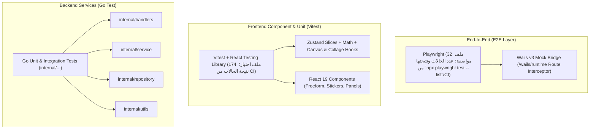

# Grido Studio Testing Guide 🧪

دليل شامل لنظام الاختبارات المتكامل في **Grido Studio**، يغطي طبقات الهرم الاختباري الثلاث (Backend Go، Frontend Vitest، و Playwright E2E مع Wails v3 Mock Bridge).
> **سجلات التشغيل التاريخية:** نتائج جلسات الاختبار السابقة مفصولة في [`docs/archive/testing-history.md`](archive/testing-history.md). الأرقام المرجعية الحية في [`docs/DOCUMENTATION_MAP.md`](DOCUMENTATION_MAP.md).

## 1. المعمارية العامة لنظام الاختبارات

تم تصميم نظام الاختبارات ليعكس بنية التطبيق الهجينة (Go Backend + React 19 Frontend + Wails v3 Desktop Runtime):



---

## 2. معمارية جسر المحاكاة Wails v3 Mock Bridge

### 2.1 كيف يعمل اتصال Wails v3 في المتصفح؟

عند تشغيل التطبيق في بيئة متصفح (Web Browser / Playwright Headless)، لا يتوفر محرك WebView2 الأصلي لسطح المكتب. يقوم موديول `@wailsio/runtime` بإرسال طلبات POST إلى:
`POST /wails/runtime`

الحمولة المشفرة تكون بالشكل:

```json
{
  "object": 0,
  "method": 0,
  "args": {
    "call-id": "wails-call-12345",
    "methodID": 2229562725,
    "args": []
  }
}
```

### 2.2 دور `frontend/e2e/helpers/wails-v3-bridge.ts`

1. **اعتراض طلبات HTTP:** يقوم باعتراض مسار `**/wails/runtime` عبر `page.route()`.
2. **فك تشفير الـ Method ID:** يطابق الرقم البرمجي للطريقة ويستجيب بنتيجة JSON فورية.
3. **تفعيل ترخيص Pro فوري:** اعتراض الطريقة `2229562725` (`GetLicenseStatus`) وإرجاع كائن ترخيص مفعّل برقم تجاري دائم، مما يمنع تجمد الاختبارات في شاشة "النسخة مقفلة".
4. **محاكاة مزود الصور المحلي:** اعتراض `**/local-image/**` وتزويد المتصفح بصور شفافة 1×1 بكسل بصيغة PNG صالحة لمنع أعطال CORS و 404.
5. **حقن التوافقية لـ `window.go`:** حقن دوال وهمية ذكية في الـ Global Window لتلبية متطلبات المخازن القديمة إن وجدت.

### 2.3 كيفية إضافة مسار أو دالة Wails Backend جديدة للـ Mock Bridge

عند إضافة دالة Go جديدة في `internal/handlers` وتوليد روابط Wails bindings:

1. افتح ملف الربط المولد في `frontend/bindings/grido/...` لمعرفة `methodID` الخاص بالدالة.
2. افتح `frontend/e2e/helpers/wails-v3-bridge.ts`.
3. أضف الـ Method ID إلى خريطة المعالجات `WAILS_V3_METHOD_MAP`:

```typescript
case 1234567890: // اسم الدالة الجديدة
  return { success: true, data: "Mocked response" };
```

---

## 3. أوامر تشغيل الاختبارات السريعة

### 3.1 عبر Taskfile (الموصى به للمشروع كاملاً)

| الأمر                | الوصف                                                                                                | الطبقة المستهدفة         |
| :------------------- | :--------------------------------------------------------------------------------------------------- | :----------------------- |
| `task test:all`      | تشغيل كافة اختبارات الباكيند والفرونت إند و E2E كاملة                                                | المشروع بالكامل          |
| `task test:backend`  | تشغيل كافة اختبارات الـ Go backend مع تفاصيل الحزم                                                   | Backend (`internal/...`) |
| `task test:frontend` | تشغيل كافة اختبارات Vitest للفرونت إند (العدد المرجعي في `docs/DOCUMENTATION_MAP.md`) | Frontend Unit/Component  |
| `task test:e2e`      | تشغيل اختبارات Playwright E2E السريعة على Chromium                                                   | E2E Browser              |

### 3.2 عبر npm للواجهة (`npm --prefix frontend ...` أو بتعيين `Cwd=frontend`)

```bash
# فحص الأنواع والتنسيق واختبارات Vitest المستهدفة (محلياً لملف واحد فقط)
npm --prefix frontend run typecheck
npm --prefix frontend run lint
npm --prefix frontend run format:check
npx --prefix frontend vitest run test/<file>.test.ts --maxWorkers=1 --no-file-parallelism --coverage.enabled=false

# تشغيل الحزمة الشاملة وPlaywright E2E (في GitHub Actions CI فقط — ممنوع محلياً على الوكلاء)
npm --prefix frontend run test:all
npm --prefix frontend run test
npm --prefix frontend run test:e2e:fast
```

### 3.3 عبر Go CLI في مجلد المشروع الرئيسي

```bash
# تشغيل جميع اختبارات الباكيند متجاوزاً الكاش
go test -count=1 -v ./internal/...
```

---

### 3.4 بوابة التوثيق (قبل أي كومت)

| الأمر                                      | الوصف                                                                                                                                   |
| :----------------------------------------- | :-------------------------------------------------------------------------------------------------------------------------------------- |
| `node scripts/docs-gate.mjs`               | تفحص الأرقام المرجعية والجرد و**تأكيدات التحقق على الكود** وتشترط توثيقاً مرافقاً لأي تغيير كود (تُشغَّل آلياً عبر `.husky/pre-commit`) |
| `node scripts/docs-gate.mjs --push`        | نفس الفحوص على مدى الكومتات غير المدفوعة (تُشغَّل آلياً عبر `.husky/pre-push`)                                                          |
| `node scripts/docs-gate.mjs --strict-refs` | يجعل مراجع المسارات في `.agents/` مُعِقة (نفس مهمة `wails3 task docs:check`)                                                            |
| `GRIDO_DOCS_GATE=off`                      | تخطّي طارئ مبرَّر — يجب ذكر السبب في رسالة الكومت                                                                                       |

> 🔒 **تأكيدات التحقق على الكود (فحص 5):** كل بند وُسم ✅ في `BUGS_REPORT.md` له دليل نصّي مُثبَّت في صفيف `CODE_ASSERTIONS` داخل `scripts/docs-gate.mjs`. إن عاد العيب إلى الكود (أو حُذف دليل الإصلاح) **تفشل البوابة ويفشل CI** — ومُثبَت باختبار انحراف سالب على `window_state.go` (`utils.AtomicWriteFile`). **لا تُحذف التأكيدات لتفادي الفشل** — أصلح الكود أو أضف تصحيحاً مؤرَّخاً.

> 📚 المرجع الكامل: `docs/DOCUMENTATION_MAP.md` · السجل والسكيمة: `changelog/README.md`.

---

### 3.5 بوابات التنسيق والالتزام (Pre-Commit / CI)

| البوابة              | الأمر                                         | النطاق                                                | الحالة عند الفشل           |
| :------------------- | :-------------------------------------------- | :---------------------------------------------------- | :------------------------- |
| Prettier             | `npm --prefix frontend run format:check`      | `src`, `test`, `e2e`, وملفات إعداد Vite/Vitest/ESLint | ⛔ في CI                   |
| ESLint               | `npm --prefix frontend run lint`              | نفس النطاق + `--max-warnings 0`                       | ⛔ في CI و`lint-staged`    |
| Go Format            | `git ls-files -z '*.go' \| xargs -0 gofmt -l` | كل ملفات Go المتتبعة                                  | ⛔ في CI                   |
| Conventional Commits | `node scripts/commit-msg-lint.mjs "$1"`       | رسالة كل كومت                                         | ⛔ عبر `.husky/commit-msg` |

- **`lint-staged`** يشغّل ESLint وPrettier على الملفات المرحّلة فقط، بينما CI يفحص الشبكة كاملة — فلا تمرّ مخالفة تنسيق أو استيراد من كومت محلي.
- **`.editorconfig`** هو مرجع المسافات (2 للملفات العامة، Tab لـGo) ونهايات الأسطر، و**`.gitattributes`** يثبّت `lf` في Git ويعزل الأصول الثنائية عن التطبيع.
- **`.nvmrc`** يحمل إصدار Node المرجعي (22)، وCI يقرأه عبر `node-version-file` بدل رقم مكرر في أكثر من مكان.
- **رسائل الالتزام:** النوع من القائمة المسموحة فقط (`build/chore/ci/docs/feat/fix/perf/refactor/release/revert/security/style/test`)، مع scope اختياري بحروف صغيرة، وترويسة حتى 120 حرفاً. تُقبل رسائل الدمج و`fixup!/squash!/amend!` و`Revert "..."` تلقائياً.

---

## 4. إرشادات كتابة الاختبارات (Best Practices)

### 4.1 اختبارات مكونات React (Vitest + RTL)

- **مزوّد التلميحات الموحد:** يجب دائماً تغليف المكونات بـ `<TooltipProvider>` لتجنب أخطاء Radix Tooltip السياقية.
- **تسميات Fluent 2 وأدوار الوصولية (ARIA):**
  - الكبسولات وشارات التصفية (`FluentFilterChips`) تمتلك دور `role="tab"`.
  - الأزرار المستقلة تمتلك دور `role="button"`.
- **مسارات WASM (OpenCV / scanic):** لا يتهيّأ الـWASM في jsdom، فكل اختبار يمرّ عبر ذلك المسار يحتاج **محاكاة هيكلية** لا تشغيلاً حقيقياً. نقطة الحقن القائمة: `getLoadedOpenCV()` في `opencv-loader.ts` يقرأ `globalThis.cv` إن كان فيه `Mat` دالة — فيُحقن كائن محاكاة بلا أي تعديل على كود الإنتاج. النموذج المرجعي الكامل (حساب `Mat`/`MatVector` وحذفها، سياق 2D مصغّر لـ`drawImage`/`getImageData`، وتحقق الطفرات): `src/components/editor/document-scanner/__tests__/opencv-detector.test.ts`. **قاعدة:** أي مسار WASM بلا محاكاة = تغطية صفرية فعلية مهما بدت الاختبارات خضراء.
- **المدخلات ذات التهدئة المؤقتة (Debounced Inputs):** عند اختبار حقول البحث التي تستخدم `setTimeout` لتقليل الضغط (مثل تأخير 120ms في `StickerCatalog`)، يجب إجبارياً تغليف التوقع بـ `await waitFor(() => expect(...).toHaveBeenCalledWith(...))` أو استخدام مؤقات Vitest الوهمية (`vi.advanceTimersByTime`).
- **حارسة الامتثال البصري (`ui-compliance.test.ts`) — أُضيفت في الجلسة 0.53:** ملف يُثبّت أن ثوابت `lib/ui/ui-compliance.ts` مُطبَّقة فعلياً، لا مجرد نصوص معيارية. يفحص قراءة الملفات المصدرية (عبر `fs`) وليس تصييرها: وجود حلقة التركيز المزدوجة على المكوّنات التفاعلية، ومنع `z-index` خام خارج طبقات Radix المشروعة، وتعريف كل رمز `--z-*` مستخدم فعلاً في `index.css`. **قاعدة:** أي ثابت جديد في `ui-compliance.ts` يجب أن يُرفَق بحالة اختبار هنا، وإلا فهو مثل لم يُحرس بعد — وقد استُخدم هذا الملف ليكشف عيباً حقيقياً (رمز `--z-titlebar` غير معرَّف أصدَر طبقة مفقودة في أزرار الإطار).
- **اختبارات ثابت المقاس (`canvas-fit.test.ts`) — مجموعة M15:** تُثبّت أن `computeCanvasDisplay` تُعيد `stageW/stageH` لا يتأثران بالزوم بينما `displayW/H` يتبعانه، وأن نسبة الأبعاد محفوظة ولا تنحل القيم في الحاويات الفارغة. أي تعديل على محرك الزوم يجب أن يُبقي هذه المجموعة خضراء قبل أي مراجعة بصرية.
- **Golden vectors للاستعدال (`scanner-warp-golden.test.ts`) — الجلسة 1.43:** شبكة أمان المرحلة 0 من ترحيل الماسح العصبي (`docs/plans/neural-scanner-warp-migration-spec.md`): 15 حالة (3 صور × 5 مضلعات) تثبّت مخرجات `warpSourceImage` (قصّ + Homography عكسي + Bilinear) بايت-ببايت من `internal/service/testdata/scanner_warp/`، مع مخرجات أوضاع الفلاتر الخمسة و8 توسيمات EXIF. **قواعد:** (1) أي تعديل مقصود على محرك الاستعدال/الفلاتر يستلزم إعادة التوليد بـ`FIXTURE_GEN=1` ثم مراجعة الفرق؛ (2) محاكي الكانفاس المشترك في `test/helpers/scanner-canvas-mock.ts` مصدره واحد — تعديله يغيّر المخرجات الملتقطة فيستلزم إعادة توليد؛ (3) هذه الـfixtures مرجع توازي Go (RMSE < 1.5/255) في المرحلة 1 — لا تُحذف إلا مع أرشفة الخطة.

### 4.2 اختبارات الـ E2E بـ Playwright

- **تجهيز التطبيق الأولي:** استخدم دائماً المساعد القياسي:
  ```typescript
  import { setupWailsV3Mock, waitForAppReady } from "./helpers/wails-v3-bridge";

  test.beforeEach(async ({ page }) => {
    await setupWailsV3Mock(page);
    await page.goto("/");
    await waitForAppReady(page);
  });
  ```
- **تجنب تضارب التحديد الصارم (Playwright Strict Mode):** عند استخدام `.or()`، احرص على استخدام `.first()` في حال تطابق عنصرين لتفادي خطأ `strict mode violation`.
- **معالجة النوافذ المنبثقة (Radix Overlays):** نظراً لأن خلفيات الأكريليك (`fluent-smoke-backdrop`) قد تعترض نقرات الفأرة، يُفضل إغلاق النوافذ عبر `page.keyboard.press('Escape')` وهو السلوك القياسي لـ Fluent 2.

---

## 5. حالة التغطية الحالية (Baseline Metrics)

- **Go Backend (بوابة دورية جديدة):** وظيفة `Backend Race & Coverage (Scheduled)` في `.github/workflows/ci.yml` تعمل أسبوعياً وعند `workflow_dispatch` عبر `go test -race -covermode=atomic -coverprofile=coverage.out ./internal/...`، تطبع الملخص وترفع `coverage.out` لمدة 14 يوماً. هي تشخيص دوري مستقل عن المسار السريع لكل push؛ لا تُثبت عتبة رقمية قبل تكوين baseline سحابي فعلي.
- **ثبات E2E:** مواصفة Transformer تعتمد `expect.poll` على هندسة العقدة الفعلية، وأُزيلت فواصل `waitForTimeout` الثابتة بين ضغطات المفاتيح. ومواصفة لوحة الأدوات تثبت مصدرًا واحدًا داخل **Radix Dialog واحد** (`command-palette` واحد + `dialog-content` واحد) لأن الحوار هو الآن مالك focus trap وعودة التركيز، وليس نسخة أوامر ثانية.

> 📌 الأرقام المرجعية الحاكمة (وروابط أوامرها) في `docs/DOCUMENTATION_MAP.md` القسم 4. أي رقم يُحدَّث من أمره فقط — لا من الذاكرة. (التحقق الثقيل يُشغَّل في GitHub Actions.)

- **Go Backend:** اختبارات `internal/...` و`native_image_drop_test.go` تغطي الخدمات والمستودعات وخادم الأصول ومسارات الطباعة والماسح وCMYK (`print_cmyk_tiff_test.go`, `print_fullpage_cmyk_test.go`).
- **Vitest & Playwright E2E:** عدد الملفات الحيّ في بلوك `docs-metrics` ضمن `docs/DOCUMENTATION_MAP.md`؛ التفاصيل التاريخية للجلسات السابقة في `docs/archive/testing-history.md`.
- **التغطية (Coverage):** الحدود الدنيا في `frontend/vitest.config.ts` (statements 36 / branches 30 / functions 32 / lines 36) وتُقرأ الأرقام الفعلية من `coverage/coverage-summary.json` في CI.
- **GitHub Step Summaries:** يقوم خط الأنابيب بتوليد لوحات إحصائية وتلخيصات بصرية تلقائية لجميع مهام البناء والاختبار لكل عملية دمج أو دفع.
- **بوابة التوثيق:** خطوة `Documentation Gate` (`node scripts/docs-gate.mjs`) تفشل البناء عند انحراف أي رقم مرجعي أو وجود مستند غير مُسجَّل — راجع `docs/DOCUMENTATION_MAP.md`.
