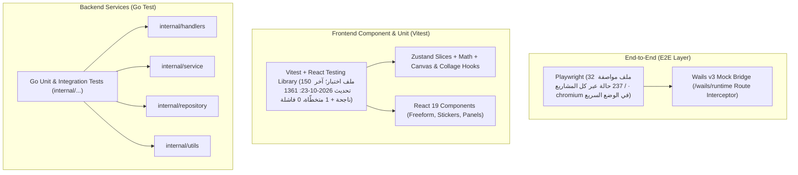

# Grido Studio Testing Guide 🧪

دليل شامل ومفصل لنظام الاختبارات المتكامل في **Grido Studio**، يغطي طبقات الهرم الاختباري الثلاث (Backend Go، Frontend Vitest، و Playwright E2E مع Wails v3 Mock Bridge)، وطرق تشغيلها وصيانتها وإضافة حالات اختبار جديدة.

---

## تنفيذ خطة الإصلاح الشاملة — 29 أكتوبر 2026

- **Go — حماية مراجع التنظيف:** `TestCleanupUnusedMedia_EditorStateReferenceIsProtected` في `internal/repository/db_test.go` يفتح SQLite مؤقتة ويمرّر صف مشروع حقيقياً إلى `cleanupProjects` ثم يشغّل المسارين: `runCleanupMedia` (عتبة 7 أيام) و`CleanUnusedMediaNow` (عتبة 24 ساعة). يثبت بقاء صورة مذكورة داخل `EditorState` فقط ونقل اليتيمة إلى `MediaTrash`. الأمر: `go test ./internal/repository -run TestCleanupUnusedMedia_EditorStateReferenceIsProtected -v` — ناجح محلياً.
- **Vitest — قوائم التعبئة:** `frontend/test/collage-autofill-tab.test.tsx` (12 حالة) تغطي حفظ التكرار المقصود، سقف 500، تحويل الفائض إلى `collagePendingImages`، تعطيل أزرار الالتقاط والاستيعاب عند السقف، والاستيعاب بعد الحذف. `frontend/test/collage-autofill-plan.test.ts` يغطي تخطيط التعبئة.
- **Vitest — الحفظ والاستعادة:** حالة round-trip جديدة في `frontend/test/project-serializer.test.ts` (17 حالة) تثبت حفظ `autofillImages` و`collagePendingImages` عبر ملف المشروع و`domain.Project` مع الحفاظ على التكرار.
- **Vitest — الطباعة:** `frontend/test/print-physical-parity.test.ts` (مقارنة تقريبية 8 خانات عشرية) و`frontend/test/print-export-payload.test.ts` و`frontend/test/export-dialog.test.tsx` تغطي هندسة الخانة الفيزيائية المشتركة في RGB/CMYK/الطباعة.
- **Vitest — الواجهة:** `frontend/test/App.test.tsx` (7 حالات) تثبت فتح حوار الكولاج الحر من `AppDialogsHost` وإعادة تحميل القوالب عند الحفظ؛ `frontend/test/freeform-editor.test.tsx` يغطي دورة المحرر.
- **Vitest — AI:** `frontend/test/ai-enhance-collage.test.tsx` و`ai-result-commit.test.ts` يغطيان المعاينة غير المدمرة وربط الناتج بالهدف الحالي (23 حالة AI مستهدفة ناجحة).
- **CI — Python:** مهمة `validate-modal-ai` في `.github/workflows/ci.yml` (Python 3.10) تثبت `modal_ai/requirements-runtime.txt` و`requirements-tooling.txt` وتشغّل `python -m unittest modal_ai.test_upscaler -v`. تُفعَّل عند تغيير `modal_ai/**` أو ملفات workflows أو يدوياً؛ لم تُشغّل سحابياً بعد لأن الدفع غير مأذون.
- **حدود التحقق:** نجحت `tsc --noEmit` وESLint `--max-warnings 0` و`oxlint` و`go vet`/`gofmt`/`build` والوحدات المستهدفة. لم تُشغَّل الحزم الكاملة أو E2E أو البناء أو CI السحابي محلياً؛ لا يُعد ذلك قبولاً بصرياً أو تحققاً من WebView2 أو Modal.
- **العداد المرجعي الحالي (يُتحقق آلياً):** 155 ملف Vitest و30 ملف مواصفة E2E و60 ملف اختبار Go و6 مستندات — بلوك `docs-metrics` في `docs/DOCUMENTATION_MAP.md`؛ الأعداد المذكورة داخل الرسم أدناه تاريخية بتاريخها.

---

## المسار السحابي المزدوج على CPU — 29 أكتوبر 2026

- `python -m unittest modal_ai.test_upscaler -v`: **19/19 ناجحة**؛ اختبارات affine عبر الدوران والتحجيم والإزاحة (خطأ النقاط ≤1e-9 بكسل في العينات)، مطابقة ROI للدمج الكامل، مقاسات فردية ووصلات tiles، غياب الوجه، JPEG Quality 98/4:4:4، Alpha 8/16-bit بمطابقة Lanczos، عقد weight scalar، حجز واحد وتسجيل واحد ورفض replay وفشل التسجيل والمدخل الكبير/التالف. المصادقة وRPC محاكيان؛ لا دليل اتصال حيّ بـ Supabase.
- قياس فعلي: `python -m modal_ai.benchmark_upscaler --models C:/projects/grido/scratch/dual-stage-models --image C:/projects/grido/scratch/dual-stage-models/portrait.jpg --sizes 256,512 --output C:/projects/grido/scratch/dual-stage-benchmark.json`. العينة صورة OpenCV العامة lena.jpg، Windows 11، CPUExecutionProvider، أربع خيوط، tiles=512/halo=36. لا GPU ولا نشر Modal. تحميل الجلسات **1.5278s** منفصل عن المعالجة.

| الدخل / الناتج | كشف الوجه | التكبير العام | ترميم/دمج وجه واحد | المعالجة | التشفير |
|---|---|---|---|---|---|
| 256² / 512² | 0.0216s | 0.8492s | 4.5627s | 5.4335s | 0.0020s |
| 512² / 1024² | 0.0207s | 3.3515s | 4.5136s | 7.8858s | 0.0112s |

- فرق tiled/full بالنموذج الحقيقي في عينة 77×65 مع tiles=40: **0 بايت** أقصى ومتوسط؛ ليس ذلك إثباتاً لكل الصور أو benchmark كبير. تحسين tile الافتراضي من 256 إلى 512 قلّل تكبير 512² من 4.2117s إلى 3.3515s في التشغيلين المقاسين، مع بقاء الحد المكاني للذاكرة.
- هذه قراءات محلية مفردة وليست median/p95 أو قياس تخصيص Modal. شرط التكبير أقل من ثانيتين لم يتحقق للدخل 512²؛ الزمن يرتفع مع المقاس وعدد الوجوه. لا ضمان 6–8 ثوانٍ لكل صورة حتى 2048²، ولا قياس شبكة/بدء حاوية أو قبول بصري بشري شامل.
- اختبارات توافق الواجهة داخل `frontend/test/ai-result-commit.test.ts` و`frontend/test/ai-enhance-collage.test.tsx`: **37/37 ناجحة** في الملفين بتشغيل مستهدف بعامل واحد؛ تغطي نسب الأبعاد الفعلية وإزاحات الخانة الحية وEXIF والصفر في التكلفة وفشل المقاس وحارس النتائج القديمة. لا يتغير عداد ملفات Vitest/E2E/Go. لم تُشغّل الحزم الثقيلة أو البناء أو E2E؛ بوابة الجرد والمراجع `node scripts/docs-gate.mjs --strict-refs`.

## تحسين حوار الطباعة — 28 أكتوبر 2026

- توسّعت حالات `frontend/test/print-dialog-backstage.test.tsx` لحماية رسالة الفراغ وتعطيل الطباعة بلا محتوى، وعرض DPI مرة واحدة دون شارة 1:1، وملاءمة الورقة في الاتجاهين إلى منفذ معاينة مقاس، والتكبير دون تغيير إعدادات الطباعة. يحاكي الاختبار مراقب القياس عند تركيب المنفذ ويتحقق من تنظيفه وإعادة ربطه بعد الإغلاق والفتح.
- جرت معاينة تفاعلية بالمظهرين الفاتح والداكن مع مصدر صورة تجريبي ومحاكاة Wails داخل المتصفح فقط، واختُبرت المقاسات والقص والتكبير والملاءمة واختيار الطابعة واستدعاء خصائصها وتبدّل زر CMYK. العرضان المكتبي والمضغوط والعرض الضيق لا يضيفون تمريراً أفقياً إلى الحوار.
- لم يُرسل طلب طباعة أصلي، ولم تُشغّل حزم الاختبارات محلياً. لا تغيير في جرد ملفات Vitest أو E2E؛ اختبارات الخدمة الأصلية وCI تبقى مطلوبة للتحقق التنفيذي الكامل.

## إعادة تصميم محرر الكولاج الحر — 28 أكتوبر 2026

- عُدلت حالات `frontend/test/freeform-editor.test.tsx` لتفصل اختيار استراتيجية التعبئة عن تنفيذها، وتغلف معاينة الورقة بمزود التلميحات المشترك. أضيفت حالات لانتقال التحديد إلى الخصائص وبقاء الخلايا والتبويب عند إخفاء اللوحة وإظهارها، وتنقل الأسهم بين التبويبات دون تحريك الخلايا، واستعادة المقاس الحالي بعد تغيير أبعاده.
- المعاينة التفاعلية عبر Vite ومتصفح بواجهات Wails محاكاة شملت التعبئة والتراجع، تحرير الأبعاد وقفل النسبة، تكرار الخلية، حارس الإغلاق، الحفظ كقالب والتطبيق وإعادة الفتح، وتدوير الورقة وتكبيرها وملاءمتها، وسحب خلية بعد التكبير واستيراد JSON صالح ورفض التالف وتصدير التخطيط. تمت مراجعة المظهرين الفاتح والداكن والعرض المكتبي والمضغوط والهاتف؛ ليست هذه اختبارات لخدمات Go أو ملفات الطباعة الأصلية.
- فجوة قائمة خارج النطاق: تغيير حجم التطبيق عبر نقطة الانتقال إلى هيكل الهاتف يفك تركيب المضيف ويغلق المحرر؛ فتحه مجدداً على العرض الضيق يسمح بإخفاء لوحته دون تمرير أفقي في الحوار.
- لم تُشغّل حزم Vitest أو Playwright E2E أو Go محلياً؛ تنفيذ حالات الانحدار الجديدة ينتظر CI. لم يتغير عدد ملفات الاختبارات أو مواصفات E2E.

## إصلاحات مراجعة ما قبل الرفع — 28 أكتوبر 2026

- `TestPrintNative_RelativeAppDir` في `internal/service/print_native_test.go` و`TestPrintNative_GDI_RelativeAppDir` في `internal/service/printer_gdi_windows_test.go` يغطيان الملفات النسبية والمطلقة داخل Exports عند `GRIDO_APP_DIR=grido-data`، ورفض الشقيق ExportsEvil. البيئة تُعزل بـ `t.Chdir(t.TempDir())` وتُستعاد تلقائياً، ولا يُطلق اختبار الحارس نافذة طباعة.
- توسّع اختبار ربط التبويبات في `frontend/test/App.test.tsx` ليفحص وجود لوحة لكل `aria-controls` وعكس `aria-labelledby` وإخفاء الألواح غير النشطة وعدم تركيب محتوى القوالب غير النشط.
- التحقق النهائي: التشغيل السحابي `40695205979` على الالتزام `951d1f2` نجح بالكامل في جميع مهام CI المُفعّلة، بما فيها Windows Build Verification واختبارات `TestPrintNative_RelativeAppDir` و`TestPrintNative_GDI_RelativeAppDir`، والواجهة والخلفية وأجزاء E2E الأربعة وWebKit والتوثيق. Admin Web متخطّى آلياً لعدم وجود تغييرات في نطاقه؛ لا ادعاء باختباره في هذه الدفعة.
- أضيفت الحالات داخل الملفات القائمة؛ لم يتغير عدد ملفات Vitest/E2E/Go. التشغيل التنفيذي موكول إلى GitHub Actions، ولا تُشغّل الحزم الثقيلة محلياً.

## مراجعة هيكل ومظهر الكولاج — 28 أكتوبر 2026

- توسّعت حالة `frontend/test/App.test.tsx` للتحقق من ربط تبويب «مخصص» بلوح المحتوى بالمعرّفات و`aria-controls`، وحالة `frontend/test/collage-arrange-tab.test.tsx` لاتجاه المخطط LTR وتمييز الخانات بأسماء وصول واضحة.
- أُضيفت حالة في `frontend/e2e/collage-panels.spec.ts` تتحقق من أن رابط «الإطار وخطوط القص» يعيد فتح المفتش المغلق ويختار إعدادات الكولاج بعد زيارة تبويب الورقة.
- لم يتغير عدد ملفات الاختبارات أو مواصفات E2E؛ الحالات الجديدة غير مشغّلة محلياً وفق دستور المشروع. نجح فحص الأنواع وESLint ونُسّقت الملفات المعدلة، ولم تُشغّل المعاينة أو خدمات Wails للتحقق البصري.

## مراجعة هندسة الكولاج وخطوط القص — 27 أكتوبر 2026

- ملف جديد `frontend/test/collage-grid-math.test.ts` (6 حالات): بقاء الفجوة/الهامش الصفريين صفراً، احتساب السعة بالهوامش والفواصل، التزام الباني بالسعة بلا تصغير، تطابق باني الواجهة مع `computeDynamicCollageCells`، وتطابق مقاسات الصور مع مولّد الخلايا لكل نوع.
- `frontend/src/lib/print/cut-lines-utils.test.ts` (+2): حدّان متلاصقان بخطأ عائم (فجوة صفر) يبقيان فاصلين بخط قص بينهما، والتداخل الحقيقي يُدمج فلا يمر خط قص عبر الصور.
- `frontend/test/print-payload-builder.test.ts` (+1): نمط cropmarks يحجب خط النهاية الممتد عن حمولة Go كي لا يتوسع صندوق الزوايا إلى حدود الورقة.
- لم تُشغّل حزم Vitest أو E2E محلياً (سياسة CI)؛ التحقق المحلي اقتصر على typecheck وESLint وبوابة التوثيق.

## مراجعة توزيع مساحة العمل — 27 أكتوبر 2026

- اختبارات `FluentSliderField` في `frontend/test/fluent-blocks.test.tsx` أصبحت تغطي تخطيطي `stacked` و`inline` بالقيم الرقمية والتقييد والإدخال العربي وإعادة التعيين نفسها، دون إضافة ملفات اختبارات.
- استثناء الحاوية الجذرية لشريط الأدوات (`h-10`) من فحص ارتفاع الأزرار في `frontend/test/toolbar-height-uniformity.test.ts` لضمان أن الفحص يختبر أزرار الأدوات الداخلية (`h-8`) دون الاشتباه في حاوية الشريط بعد ضغطها إلى 40px.
- فُحصت واجهة App الفعلية في متصفح مع محاكي Wails محلي: اللوحتان بعرضهما الأصلي، شريط الأدوات 40px والتذييل 32px، وعدم تداخل الأعمدة أو تمرير اللوحتين أفقياً بعروض 1600 و1280 و1024 بكسل؛ وأسماء منزلقات الألوان وقيمها ومساراتها متجاورة في صف واحد مع بقاء تعديلها بلوحة المفاتيح.
- لم تُشغّل حزم Vitest أو E2E محلياً؛ توسعة حالات الوحدة تنتظر CI. محاكاة المتصفح لا تختبر خدمات Wails الأصلية.

## مراجعة رسوم الملصقات — 23 أكتوبر 2026

- توسّع `frontend/test/sticker-text.test.ts` لتغطية عرض الحقل `data-max-width`، والقيم القصيرة الكبيرة، وطول القوس المخصص، وتحجيم التباعد اللاتيني، وقياس الرموز الخاصة دون فقد النص.
- أضيف حارس بقاء `data-field-id` دون بادئة في `sticker-text`، وحارس تضمين أوزان الخط ومجموعاته العربية واللاتينية مع `unicode-range` في `frontend/test/sticker-phase2.test.ts`؛ مسار PNG يستخدم مُضمّن الخط نفسه المستخدم في SVG قبل التصيير.
- أضيف في `frontend/test/sticker-studio.test.tsx` اختبار لوراثة `data-color-role` في `StickerPreview` واختبار لحفظ `stickerSource` عند الإدراج السريع من `FreeformElementsTab` لتفعيل «تعديل الملصق» من قائمة السياق.
- بقيت معرّفات القوالب والحقول والمقاسات والبيانات العراقية تحت حراسة `frontend/test/sticker-templates.test.ts`؛ لم يتغير عدد ملفات الاختبارات.
- تُشغّل حزم Vitest وE2E في CI وفق دستور المشروع، لا محلياً؛ نتائج التشغيل الكامل السابقة أدناه ليست تحققاً من هذه التغييرات.

## 1. المعمارية العامة لنظام الاختبارات

تم تصميم نظام الاختبارات ليعكس بنية التطبيق الهجينة (Go Backend + React 19 Frontend + Wails v3 Desktop Runtime):



---

## 2. معمارية جسر المحاكاة Wails v3 Mock Bridge

### 2.1 كيف يعمل اتصال Wails v3 في المتصفح؟
عند تشغيل التطبيق في بيئة متصفح (Web Browser / Playwright Headless)، لا يتوفر محرك WebView2 الأصلي لسطح المكتب. يقوم موديول `@wailsio/runtime` بإرسال طلبات POST إلى:
`POST /wails/runtime`

الحمولة المشفرة تكون بالشكل:
```json
{
  "object": 0,
  "method": 0,
  "args": {
    "call-id": "wails-call-12345",
    "methodID": 2229562725,
    "args": []
  }
}
```

### 2.2 دور `frontend/e2e/helpers/wails-v3-bridge.ts`
1. **اعتراض طلبات HTTP:** يقوم باعتراض مسار `**/wails/runtime` عبر `page.route()`.
2. **فك تشفير الـ Method ID:** يطابق الرقم البرمجي للطريقة ويستجيب بنتيجة JSON فورية.
3. **تفعيل ترخيص Pro فوري:** اعتراض الطريقة `2229562725` (`GetLicenseStatus`) وإرجاع كائن ترخيص مفعّل برقم تجاري دائم، مما يمنع تجمد الاختبارات في شاشة "النسخة مقفلة".
4. **محاكاة مزود الصور المحلي:** اعتراض `**/local-image/**` وتزويد المتصفح بصور شفافة 1×1 بكسل بصيغة PNG صالحة لمنع أعطال CORS و 404.
5. **حقن التوافقية لـ `window.go`:** حقن دوال وهمية ذكية في الـ Global Window لتلبية متطلبات المخازن القديمة إن وجدت.

### 2.3 كيفية إضافة مسار أو دالة Wails Backend جديدة للـ Mock Bridge
عند إضافة دالة Go جديدة في `internal/handlers` وتوليد روابط Wails bindings:
1. افتح ملف الربط المولد في `frontend/bindings/grido/...` لمعرفة `methodID` الخاص بالدالة.
2. افتح `frontend/e2e/helpers/wails-v3-bridge.ts`.
3. أضف الـ Method ID إلى خريطة المعالجات `WAILS_V3_METHOD_MAP`:
```typescript
case 1234567890: // اسم الدالة الجديدة
  return { success: true, data: "Mocked response" };
```

---

## 3. أوامر تشغيل الاختبارات السريعة

### 3.1 عبر Taskfile (الموصى به للمشروع كاملاً)

| الأمر | الوصف | الطبقة المستهدفة |
| :--- | :--- | :--- |
| `task test:all` | تشغيل كافة اختبارات الباكيند والفرونت إند و E2E كاملة | المشروع بالكامل |
| `task test:backend` | تشغيل كافة اختبارات الـ Go backend مع تفاصيل الحزم | Backend (`internal/...`) |
| `task test:frontend` | تشغيل كافة اختبارات Vitest للفرونت إند (150 ملف اختبار — العدد المرجعي في docs/DOCUMENTATION_MAP.md) | Frontend Unit/Component |
| `task test:e2e` | تشغيل اختبارات Playwright E2E السريعة على Chromium | E2E Browser |

### 3.2 عبر npm في مجلد `frontend`

```bash
cd frontend

# تشغيل فحص الأنواع الصارم والتنسيق ثم كل اختبارات Vitest واختبارات E2E
npm run test:all

# تشغيل اختبارات Vitest فقط (سريعة - ثوانٍ معدودة)
npm run test

# تشغيل اختبارات Vitest في وضع المراقبة التفاعلي أثناء التطوير
npm run test:watch

# تشغيل اختبارات Playwright السريعة (Chromium Headless)
npm run test:e2e:fast

# تشغيل Playwright مع الواجهة الرسومية التفاعلية والتنقيح البصري
npm run test:e2e:ui
```

### 3.3 عبر Go CLI في مجلد المشروع الرئيسي

```bash
# تشغيل جميع اختبارات الباكيند متجاوزاً الكاش
go test -count=1 -v ./internal/...
```

---

### 3.4 بوابة التوثيق (قبل أي كومت)

| الأمر | الوصف |
| :--- | :--- |
| `node scripts/docs-gate.mjs` | تفحص الأرقام المرجعية والجرد و**تأكيدات التحقق على الكود** وتشترط توثيقاً مرافقاً لأي تغيير كود (تُشغَّل آلياً عبر `.husky/pre-commit`) |
| `node scripts/docs-gate.mjs --push` | نفس الفحوص على مدى الكومتات غير المدفوعة (تُشغَّل آلياً عبر `.husky/pre-push`) |
| `node scripts/docs-gate.mjs --strict-refs` | يجعل مراجع المسارات في `.agents/` مُعِقة (نفس مهمة `wails3 task docs:check`) |
| `GRIDO_DOCS_GATE=off` | تخطّي طارئ مبرَّر — يجب ذكر السبب في رسالة الكومت |

> 🔒 **تأكيدات التحقق على الكود (فحص 5):** كل بند وُسم ✅ في `BUGS_REPORT.md` له دليل نصّي مُثبَّت في صفيف `CODE_ASSERTIONS` داخل `scripts/docs-gate.mjs`. إن عاد العيب إلى الكود (أو حُذف دليل الإصلاح) **تفشل البوابة ويفشل CI** — ومُثبَت باختبار انحراف سالب على `window_state.go` (`utils.AtomicWriteFile`). **لا تُحذف التأكيدات لتفادي الفشل** — أصلح الكود أو أضف تصحيحاً مؤرَّخاً.

> 📚 المرجع الكامل: `docs/DOCUMENTATION_MAP.md` · المهارة: `.agents/skills/grido-docs-sync-guard/SKILL.md`.

---

### 3.5 بوابات التنسيق والالتزام (Pre-Commit / CI)

| البوابة | الأمر | النطاق | الحالة عند الفشل |
| :--- | :--- | :--- | :--- |
| Prettier | `npm --prefix frontend run format:check` | `src`, `test`, `e2e`, وملفات إعداد Vite/Vitest/ESLint | ⛔ في CI |
| ESLint | `npm --prefix frontend run lint` | نفس النطاق + `--max-warnings 0` | ⛔ في CI و`lint-staged` |
| Go Format | `git ls-files -z '*.go' \| xargs -0 gofmt -l` | كل ملفات Go المتتبعة | ⛔ في CI |
| Conventional Commits | `node scripts/commit-msg-lint.mjs "$1"` | رسالة كل كومت | ⛔ عبر `.husky/commit-msg` |

- **`lint-staged`** يشغّل ESLint وPrettier على الملفات المرحّلة فقط، بينما CI يفحص الشبكة كاملة — فلا تمرّ مخالفة تنسيق أو استيراد من كومت محلي.
- **`.editorconfig`** هو مرجع المسافات (2 للملفات العامة، Tab لـGo) ونهايات الأسطر، و**`.gitattributes`** يثبّت `lf` في Git ويعزل الأصول الثنائية عن التطبيع.
- **`.nvmrc`** يحمل إصدار Node المرجعي (22)، وCI يقرأه عبر `node-version-file` بدل رقم مكرر في أكثر من مكان.
- **رسائل الالتزام:** النوع من القائمة المسموحة فقط (`build/chore/ci/docs/feat/fix/perf/refactor/release/revert/security/style/test`)، مع scope اختياري بحروف صغيرة، وترويسة حتى 120 حرفاً. تُقبل رسائل الدمج و`fixup!/squash!/amend!` و`Revert "..."` تلقائياً.

---

## 4. إرشادات كتابة الاختبارات (Best Practices)

### 4.1 اختبارات مكونات React (Vitest + RTL)
- **مزوّد التلميحات الموحد:** يجب دائماً تغليف المكونات بـ `<TooltipProvider>` لتجنب أخطاء Radix Tooltip السياقية.
- **تسميات Fluent 2 وأدوار الوصولية (ARIA):**
  - الكبسولات وشارات التصفية (`FluentFilterChips`) تمتلك دور `role="tab"`.
  - الأزرار المستقلة تمتلك دور `role="button"`.
- **مسارات WASM (OpenCV / scanic):** لا يتهيّأ الـWASM في jsdom، فكل اختبار يمرّ عبر ذلك المسار يحتاج **محاكاة هيكلية** لا تشغيلاً حقيقياً. نقطة الحقن القائمة: `getLoadedOpenCV()` في `opencv-loader.ts` يقرأ `globalThis.cv` إن كان فيه `Mat` دالة — فيُحقن كائن محاكاة بلا أي تعديل على كود الإنتاج. النموذج المرجعي الكامل (حساب `Mat`/`MatVector` وحذفها، سياق 2D مصغّر لـ`drawImage`/`getImageData`، وتحقق الطفرات): `src/components/editor/document-scanner/__tests__/opencv-detector.test.ts`. **قاعدة:** أي مسار WASM بلا محاكاة = تغطية صفرية فعلية مهما بدت الاختبارات خضراء.
- **المدخلات ذات التهدئة المؤقتة (Debounced Inputs):** عند اختبار حقول البحث التي تستخدم `setTimeout` لتقليل الضغط (مثل تأخير 120ms في `StickerCatalog`)، يجب إجبارياً تغليف التوقع بـ `await waitFor(() => expect(...).toHaveBeenCalledWith(...))` أو استخدام مؤقات Vitest الوهمية (`vi.advanceTimersByTime`).
- **حارسة الامتثال البصري (`ui-compliance.test.ts`) — أُضيفت في الجلسة 0.53:** ملف يُثبّت أن ثوابت `lib/ui/ui-compliance.ts` مُطبَّقة فعلياً، لا مجرد نصوص معيارية. يفحص قراءة الملفات المصدرية (عبر `fs`) وليس تصييرها: وجود حلقة التركيز المزدوجة على المكوّنات التفاعلية، ومنع `z-index` خام خارج طبقات Radix المشروعة، وتعريف كل رمز `--z-*` مستخدم فعلاً في `index.css`. **قاعدة:** أي ثابت جديد في `ui-compliance.ts` يجب أن يُرفَق بحالة اختبار هنا، وإلا فهو مثل لم يُحرس بعد — وقد استُخدم هذا الملف ليكشف عيباً حقيقياً (رمز `--z-titlebar` غير معرَّف أصدَر طبقة مفقودة في أزرار الإطار).
- **اختبارات ثابت المقاس (`canvas-fit.test.ts`) — مجموعة M15:** تُثبّت أن `computeCanvasDisplay` تُعيد `stageW/stageH` لا يتأثران بالزوم بينما `displayW/H` يتبعانه، وأن نسبة الأبعاد محفوظة ولا تنحل القيم في الحاويات الفارغة. أي تعديل على محرك الزوم يجب أن يُبقي هذه المجموعة خضراء قبل أي مراجعة بصرية.
- **Golden vectors للاستعدال (`scanner-warp-golden.test.ts`) — الجلسة 1.43:** شبكة أمان المرحلة 0 من ترحيل الماسح العصبي (`docs/plans/neural-scanner-warp-migration-spec.md`): 15 حالة (3 صور × 5 مضلعات) تثبّت مخرجات `warpSourceImage` (قصّ + Homography عكسي + Bilinear) بايت-ببايت من `internal/service/testdata/scanner_warp/`، مع مخرجات أوضاع الفلاتر الخمسة و8 توسيمات EXIF. **قواعد:** (1) أي تعديل مقصود على محرك الاستعدال/الفلاتر يستلزم إعادة التوليد بـ`FIXTURE_GEN=1` ثم مراجعة الفرق؛ (2) محاكي الكانفاس المشترك في `test/helpers/scanner-canvas-mock.ts` مصدره واحد — تعديله يغيّر المخرجات الملتقطة فيستلزم إعادة توليد؛ (3) هذه الـfixtures مرجع توازي Go (RMSE < 1.5/255) في المرحلة 1 — لا تُحذف إلا مع أرشفة الخطة.

### 4.2 اختبارات الـ E2E بـ Playwright
- **تجهيز التطبيق الأولي:** استخدم دائماً المساعد القياسي:
  ```typescript
  import { setupWailsV3Mock, waitForAppReady } from './helpers/wails-v3-bridge';

  test.beforeEach(async ({ page }) => {
    await setupWailsV3Mock(page);
    await page.goto('/');
    await waitForAppReady(page);
  });
  ```
- **تجنب تضارب التحديد الصارم (Playwright Strict Mode):** عند استخدام `.or()`، احرص على استخدام `.first()` في حال تطابق عنصرين لتفادي خطأ `strict mode violation`.
- **معالجة النوافذ المنبثقة (Radix Overlays):** نظراً لأن خلفيات الأكريليك (`fluent-smoke-backdrop`) قد تعترض نقرات الفأرة، يُفضل إغلاق النوافذ عبر `page.keyboard.press('Escape')` وهو السلوك القياسي لـ Fluent 2.

---

## 5. حالة التغطية الحالية (Baseline Metrics)

> 📌 الأرقام أدناه **تحقق: 2026-10-20**، والأرقام المرجعية الحاكمة (وروابط أوامرها) في `docs/DOCUMENTATION_MAP.md` القسم 4. أي رقم يُحدَّث من أمره فقط — لا من الذاكرة. (التحقق الثقيل يُشغَّل في GitHub Actions — القاعدة: لا إجهاد للبيئة المحلية.)

- **Go Backend:** `internal/handlers` و`internal/service` و`internal/repository` و`internal/server` و`internal/utils` تجتاز الاختبارات بنسبة 100% (**49 ملفاً / 255 دالة اختبار** — `go test ./internal/... -list "^Test"`؛ أضافت جلسة 0.82 دالة وملف `internal/server/asset_server_test.go`).
- **Vitest Frontend:** **150 ملف اختبار** وآخر شبكة كاملة (2026-10-23): **1356 ناجحة + 1 متخطاة (0 فاشلة)** — أضافت جلسة 1.39 ملف `test/font-selector.test.tsx` (12 حالة لمنتقي الخطوط الموحّد: قائمة بلا تصنيفات، بحث، تنقّل لوحة المفاتيح، المفضّلة، والمعاينة غير الملتزمة) وأصلحت mock `IntersectionObserver` في `test/setup.ts` (كان `mockReturnValue` محظوراً في Vitest 4 عند الاستدعاء بـ`new` فكانت 12 حالة تفشل)، وأضافت جلسة 1.38 ملف `test/text-fit.test.ts` (3 حالات لنموذج `auto/fixed` وحدود العرض وتوافق المستندات القديمة)، ووسّعت جلسة 1.36/1.37 ملفات النصوص والتبويب. التفاصيل التاريخية التالية من جلسات سابقة: **143 ملف اختبار** (عدّ آلي: 2026-10-21، بعد حذف `test/freeform-backdrops-tab.test.tsx` في جلسة 1.28 مع إزالة وجهة الهوية البصرية، وبعد إعادة تسمية اختبار أداة الورقة إلى `test/canvas-color-deck.test.tsx`؛ وبما فيها ملفا جلسة 1.24: `test/color-wheel.test.ts` و`test/color-panel.test.tsx`)؛ آخر شبكة كاملة (2026-10-21): **1250 ناجحة + 1 متخطّاة (0 فاشلة)** عبر 142 ملفاً قبل إضافة الملفين، ولم تُعَد الشبكة الكاملة بعدهما (تُشغَّل في CI). شغّلت جلسة 1.27 استهدافاً خفيفاً لملفَي `test/layers-list.test.tsx` و`test/collage-custom-grid-tab.test.tsx` بنتيجة **17/17** بعد مواءمتهما مع الحد الأدنى البصري، وشغّلت جلسة 1.28 استهدافاً على أربعة ملفات بنتيجة **56/56** بعد إعادة تصميم شريط اللون وإزالة وجهة الهوية. — أضافت جلسة 1.20 ملف `test/collage-grid.test.ts` (7 حالات لاستنتاج الشبكة من الإحداثيات وتفضيل `physicalLayout`)، وحذفت جلسة 1.18 ملف `test/export-canvas-watermark.test.ts` (حالتان) مع إزالة العلامة المائية من التصدير، وأضافت جلسة 1.21 ملف `test/mobile-panels-sheet.test.tsx`. أضافت جلسة 1.13 خمسة ملفات: `test/text-render-state.test.ts` (الأرقام العربية وتباعد الحروف وتحويل حالة الأحرف)، `test/text-layout.test.ts` (أنماط `word/char/none`)، `test/text-preset-catalog.test.ts` (سلامة كتالوج النصوص)، `test/fill-paint.test.ts` (التدرج والنقش وتحويلات الحروف المقوّسة)، و`test/fill-utils.test.ts` (أولوية التعبئة). ووسّعت `test/curved-text.test.ts` لتغطية تعبئة كل حرف. ويبقى منها ملفا نظام الأشكال: `test/shape-pattern.test.ts` (8 حالات) و`test/shape-catalog.test.ts` (3 حالات)، وعقد حمولة الطباعة `test/print-payload-builder.test.ts` (قفل إصلاحات RV-16)، و**مسار تصدير CMYK:** `test/export-cmyk.test.ts` (14 اختباراً) و`test/export-dialog.test.tsx` (11 اختباراً).
- **Go — فصل أحبار CMYK:** `print_cmyk_tiff_test.go` (وسوم `photometric=5`/`InkSet`/`SamplesPerPixel`/`ExtraSamples` + دورة قنوات حرفية + Stride لصورة فرعية + رفض مدخلات غير صالحة) و`print_fullpage_cmyk_test.go` (عقد حوار التصدير: كامل الصفحة حدّاً-لحدّ + الامتداد + قيد JPEG).
- **Playwright E2E:** **32 ملف مواصفة** يضم **237 حالة** (عدّ آلي: 2026-10-23 عبر `npx playwright test --list`) عبر كل المشاريع (chromium + firefox + webkit)؛ `npm run test:e2e:fast` يقتصر على chromium — التحقق: `npx playwright test --list`. وأضاف ملف `e2e/text-measure.spec.ts` حرّاساً حقيقيين على Chromium: قياس نص عربي ملتف على كانفاس فعلي، ملاءمة تلقائية تحافظ على المركز، وسحب زاوية محوّل يحجّم حجم الخط تناسبياً مع ثبات الركن المقابل، وسحب منتصف حافة يغيّر العرض وحده بلا مساس بحجم الخط، وسحب مقبض علوي لا يزيح النص رأسياً، وبقاء حبر النص المنحني فوق صندوقه، ومطابقة إعادة رسم الحد عند مقياس نقطة 2×. تنبيه: عنصر بحجم 48px على لوحة 2480 يُعرض بعشرات البكسلات فقط فتتداخل مقابض الحواف مع الزوايا — الحالتان ترفعان الخط إلى 200px قبل السحب لتحديد المقبض المقصود. وأضافت جلسة 1.39 ملف `e2e/export-transform.spec.ts` (حالتان لكل مشروع) كحرس تطابق موضع الحبر بين معاينة Konva والتصدير اليدوي لعنصر مدوّر (نص وصورة).
- **التغطية (Coverage):** الحدود الدنيا في `frontend/vitest.config.ts` (statements 36 / branches 30 / functions 32 / lines 36) وتُقرأ الأرقام الفعلية من `coverage/coverage-summary.json` في CI.
- **GitHub Step Summaries:** يقوم خط الأنابيب بتوليد لوحات إحصائية وتلخيصات بصرية تلقائية لجميع مهام البناء والاختبار لكل عملية دمج أو دفع.
- **بوابة التوثيق:** خطوة `Documentation Gate` (`node scripts/docs-gate.mjs`) تفشل البناء عند انحراف أي رقم مرجعي أو وجود مستند غير مُسجَّل — راجع `docs/DOCUMENTATION_MAP.md`.
